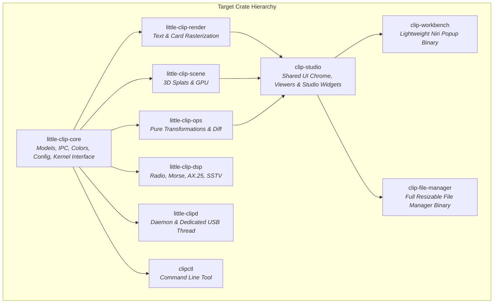

# Comprehensive Deep Refactoring Plan: Architectural Restoration & Technical Debt Elimination

## Executive Summary & Architectural Vision

This document establishes the blueprint for a systemic, root-cause refactoring of the `little-screen-clip` workspace. Over its development cycle, the workspace has accumulated significant architectural entropy—most notably a **Lava Flow anti-pattern** where legacy components, rapid prototypes, and experimental features were repeatedly layered on top of each other rather than cleanly modularized.

The primary symptom of this entropy is **Crate Inversion**:
- [`clip-workbench`](file:///home/vcarlson/little-screen-clip/crates/clip-workbench) was designed as a lightweight, centered, non-resizable popup clipboard manager for the Niri Wayland compositor. Instead, it became a massive ~40,000+ line monolith housing the entire file manager subsystem, ONNX machine learning models, SQLite databases, udev monitors, and audio/video studios.
- [`clip-file-manager`](file:///home/vcarlson/little-screen-clip/crates/clip-file-manager) was added as a wrapper crate, but inverted dependencies force it to import `clip-workbench`, which in turn forces any build of `clip-workbench` to compile heavy ML runtimes (`ort`), tokenizer regexes, SQLite engines, and complex system monitoring libraries.
- [`little-clip-ops`](file:///home/vcarlson/little-screen-clip/crates/little-clip-ops) bundles pure text/image clipboard transformations alongside amateur radio packet decoders (AX.25, APRS, SSTV, Morse DSP), Myers diff engines, and a visual node-graph execution compiler.
- Concurrency violations exist where synchronous USB bulk transfers run directly on Tokio async executors, and synchronous IPC calls block the main egui UI thread.

The goal of this refactor is not superficial aesthetic code shuffling, but **structural decoupling, non-blocking concurrency, domain separation, and drastic reduction of cyclomatic complexity**.

---

## Architectural Baseline (Current Metrics)

*Measured via `architecture_fitness` tools (`lizard`, `jscpd`, `valknut` on commit `dc4e702`):*

| Metric | Measured Baseline | Target State |
| :--- | :--- | :--- |
| **Total Lines of Code (NLOC)** | 299,063 | Cleanly partitioned across focused crates |
| **High Complexity Functions (CCN > 15)** | **293 functions** | < 50 functions |
| **Peak Cyclomatic Complexity (Max CCN)** | **205** ([`waveform.rs`](file:///home/vcarlson/little-screen-clip/crates/clip-workbench/src/audio_preview/tools/inspect/waveform.rs#L78)) | Max CCN < 25 per function |
| **Average Cyclomatic Complexity** | 4.39 | < 3.2 |
| **Duplication / Clone Ratio** | **5.56%** (19,608 lines / 1,642 clones) | < 2.0% |
| **Dependency Cycles** | 15 detected in scripts/runtime paths | 0 cycles |
| **Overall Health Score** | 67.48 / 100 | > 85.0 / 100 |

### Top Complexity Hotspots Identified

1. [`render_waveform_canvas`](file:///home/vcarlson/little-screen-clip/crates/clip-workbench/src/audio_preview/tools/inspect/waveform.rs#L78-L1510) — **CCN: 205**, NLOC: 1,315
2. [`render_ui` in image studio](file:///home/vcarlson/little-screen-clip/crates/clip-workbench/src/image_preview/studio.rs#L4-L643) — **CCN: 194**, NLOC: 593
3. [`execute_node` in pipeline executor](file:///home/vcarlson/little-screen-clip/crates/little-clip-ops/src/pipeline/executor.rs#L164-L974) — **CCN: 143**, NLOC: 760
4. [`compute_audio_analysis_inner`](file:///home/vcarlson/little-screen-clip/crates/little-clip-core/src/audio/decode.rs#L252-L1045) — **CCN: 134**, NLOC: 721
5. [`render_standard_ui` in audio inspect](file:///home/vcarlson/little-screen-clip/crates/clip-workbench/src/audio_preview/tools/inspect/studio.rs#L64-L839) — **CCN: 128**, NLOC: 697
6. [`render_ui_with_copy_dispatch` in midi studio](file:///home/vcarlson/little-screen-clip/crates/clip-workbench/src/midi_view/studio.rs#L15-L803) — **CCN: 129**, NLOC: 684
7. [`render_markup_overlay`](file:///home/vcarlson/little-screen-clip/crates/clip-workbench/src/image_preview/tools/markup/overlay.rs#L184-L959) — **CCN: 110**, NLOC: 722
8. [`map_extension_to_language`](file:///home/vcarlson/little-screen-clip/crates/little-clip-core/src/syntax.rs#L296-L411) — **CCN: 111**, NLOC: 116
9. [`icons.rs::name` and `uri`](file:///home/vcarlson/little-screen-clip/crates/clip-workbench/src/icons.rs#L125-L351) — **CCN: 108**, NLOC: 112 each
10. [`update` in workbench](file:///home/vcarlson/little-screen-clip/crates/clip-workbench/src/workbench/update.rs#L4-L516) — **CCN: 81**, NLOC: 467

---

## Dynamic Expansion Protocol

> [!IMPORTANT]
> **No single planning pass can uncover all hidden coupling, implicit assumptions, or edge cases in a 300k-LOC codebase.**
> This plan defines **broad-scope architectural initiatives** with explicit boundaries. Engineers and agents executing this plan must dynamically expand each phase into granular subtasks as code is examined and unpacked.

When executing any phase of this plan:
1. **Pre-Task Inspection**: Inspect the immediate dependencies, callers, and test harnesses for the targeted subsystem.
2. **Dynamic Task Registration**: If previously uncataloged coupling, dead code, or circular dependencies are discovered, add them explicitly as sub-items under the active phase before making changes.
3. **Incremental Commits**: Commit changes atomically per logical task (e.g., `refactor(crate): extract studio widgets into clip-studio`). Never combine unrelated multi-crate migrations into a single mega-commit.
4. **Verification Gates**: After every task, run:
   ```bash
   cargo fmt --check
   cargo clippy --workspace --all-targets -- -D warnings
   cargo test --workspace
   ```
5. **Architectural Verification**: Run `architecture_hotspots` or `architecture_compare` to verify that cyclomatic complexity and duplicate clone groups are decreasing monotonically.

---

## Refactoring Initiatives & Target Domains



---

### Phase 1: Crate Inversion & Dependency Untangling

#### Problem Statement
[`crates/clip-workbench`](file:///home/vcarlson/little-screen-clip/crates/clip-workbench) currently functions as both a UI library, a background worker runner, a full-fledged file browser, and a clipboard popup. It pulls in heavy third-party dependencies (`ort`, `rusqlite`, `tokenizers`, `udev`, `trash`, `fuse-binwalk`, `raw-cpuid`, `realfft`, `hound`, `rodio`) that are only used by the file manager or specific media studios. Meanwhile, [`crates/clip-file-manager`](file:///home/vcarlson/little-screen-clip/crates/clip-file-manager) is an empty shell that depends backwards on `clip-workbench`.

#### Architectural Solution
1. **Extract Shared Studio Crate (`crates/clip-studio`)**:
   - Move shared egui components out of `clip-workbench`:
     - Media viewers: `audio_preview/`, `image_preview/`, `text_preview/`, `pdf_view/`, `midi_view/`, `spreadsheet_view/`, `binary_diff_view/`, `diff_view/`, `canvas/`, `shell/`.
     - Shared UI infrastructure: `ui_ext.rs`, `ui_appearance.rs`, `icons.rs`, `ansi.rs`, `file_source.rs`.
   - Ensure `clip-studio` depends only on `little-clip-core`, `little-clip-render`, `little-clip-ops`, and `egui`/`eframe`.
2. **Relocate File Manager to `crates/clip-file-manager`**:
   - Move the entire `crates/clip-workbench/src/file_manager/` tree directly into `crates/clip-file-manager/src/`.
   - Transfer file-manager-specific dependencies from `clip-workbench/Cargo.toml` to `clip-file-manager/Cargo.toml`:
     - `ort`, `rusqlite`, `tokenizers`, `udev`, `trash`, `fuse-binwalk`, `raw-cpuid`.
   - Invert the Cargo dependency: `clip-file-manager` depends on `clip-studio` and `little-clip-core`. It no longer depends on `clip-workbench`.
3. **Partition Worker CLI Dispatches**:
   - Currently, `crates/clip-workbench/src/worker_cli.rs` intercepts `--internal-file-search-reader`, `--internal-system-inspector`, `--internal-barcode-reader`, etc., via `/proc/self/exe`.
   - Separate file-search and system-inspector worker dispatchers into `clip-file-manager`.
   - Keep only clipboard-relevant workers in `clip-workbench` (or share generic worker boilerplate via `little-clip-core::process`).
4. **SVG and Media Rendering Inconsistency**:
   - `little-clip-core::item::ImageThumbnail::generate_from_svg` attempts to shell out to an external binary `rsvg-convert` via `Command::new("rsvg-convert")`, which fails whenever `librsvg` is not installed on the system.
   - In contrast, `little-clip-render` and `clip-workbench` already include `resvg` (`resvg::usvg`) for pure-Rust SVG parsing and rasterization.
   - Consolidate SVG thumbnail rasterization to use the existing pure-Rust `resvg` rendering pipeline (shared via `little-clip-render` or `clip-studio`), eliminating the fragile external process dependency.
5. **Lean Clipboard Workbench Popup**:
   - `clip-workbench` becomes a minimal binary and UI shell containing only `workbench/` popup state, slot management, and quick clipboard viewers.
   - Dramatic build time acceleration: compiling `clip-workbench` in debug mode will no longer require compiling ONNX runtime, SQLite, or Linux udev bindings.

#### Dynamic Expansion Checklist (To be expanded during implementation)
- [ ] Catalog all cross-references between `workbench/` and `file_manager/`.
- [ ] Identify any workbench-only features mistakenly accessing file-manager state.
- [ ] Separate `worker_cli.rs` dispatch tables by application ownership.
- [ ] Verify Niri single-instance floating window rules are preserved for `clip-workbench`.
- [ ] Verify `launch.sh files` launches the decoupled `clip-file-manager` binary with identical functionality.

---

### Phase 2: Concurrency, Threading Boundaries & Non-Blocking I/O

#### Problem Statement
Multiple critical subsystems perform synchronous, blocking I/O on async runtimes or UI render threads:
1. **USB Driver Stalls in Daemon**: [`little-clipd::display_worker`](file:///home/vcarlson/little-screen-clip/crates/little-clipd/src/display_worker.rs#L7-L72) runs as a Tokio task, but executes synchronous `rusb` bulk writes (`write_bulk`) with multi-millisecond timeouts. USB hardware latency or endpoint stalls freeze the Tokio worker thread.
2. **Synchronous IPC on UI Thread**: Workbench UI event handlers call [`desktop_ipc::request`](file:///home/vcarlson/little-screen-clip/crates/clip-workbench/src/lib.rs#L923) synchronously. If `little-clipd` is busy or restarting, the egui render loop halts completely for up to 2–4 seconds.
3. **Synchronous Mount Discovery on Startup**: [`mounts.rs::scan_mounts_sync`](file:///home/vcarlson/little-screen-clip/crates/clip-workbench/src/file_manager/mounts.rs#L244) spawns `lsblk` synchronously on the main thread during `MountCache::new`, blocking window startup on systems with sleeping drives or unresponsive network shares.
4. **Per-Frame Operations in `update()`**: egui `update()` routines execute unmemoized string formatting, filesystem lookups, and regex parsing on every frame.

#### Architectural Solution
1. **Dedicated Hardware Thread for USB I/O**:
   - Isolate `rusb` communication from Tokio async tasks entirely.
   - Run the display worker on a dedicated `std::thread::Builder::new().name("trofeo-usb-io")`.
   - Use non-blocking crossbeam or Tokio bounded channels (`mpsc::channel`) to feed frames to the hardware thread.
   - Ensure timeouts and hardware reconnection logic remain confined to the I/O thread.
2. **Non-Blocking IPC & Optimistic UI State**:
   - Replace direct synchronous `send_ipc_request` calls in egui widgets with asynchronous task dispatch via `BackgroundJobs` or a dedicated UI IPC actor.
   - Operations like slot swapping, pinning, and clearing update local UI state optimistically and emit failure toasts asynchronously if the IPC request fails.
3. **Asynchronous Mount & Drive Inventory**:
   - Remove `scan_mounts_sync()` from the initialization critical path.
   - Initialize `MountCache` with `/proc/mounts` immediate parsing (zero process spawning) and spawn `lsblk` block-device scanning asynchronously on a background worker thread.
   - Update mounted drive UI reactively when the background scan resolves.
4. **Frame Rendering Memoization**:
   - Profile `update()` in all viewers and eliminate redundant per-frame allocations.
   - Cache formatted strings, file sizes, and date labels, invalidating them only when item revisions change.

#### Dynamic Expansion Checklist (To be expanded during implementation)
- [ ] Audit all uses of `send_ipc_request` and `send_ipc_request_with_timeout` across the UI.
- [ ] Implement an asynchronous `IpcClient` handle with non-blocking response polling.
- [ ] Measure startup time of `clip-file-manager` before and after async mount scanning.
- [ ] Benchmark Tokio thread starvation metrics in `little-clipd` during simulated USB disconnects.

---

### Phase 3: Domain Decoupling in Transformation Pipelines (`little-clip-ops`)

#### Problem Statement
[`crates/little-clip-ops`](file:///home/vcarlson/little-screen-clip/crates/little-clip-ops) combines fundamentally unrelated functional domains into a single crate:
- **Clipboard transforms**: Text formatting, case changes, URL cleaning, image scaling, QR/barcode generation.
- **Diff engines**: Myers text diff, binary hex diff, image visual diff.
- **Amateur radio & DSP decoders**: Morse code CW decoding, AX.25 packet radio, APRS position packets, AIS marine telemetry, SSTV analog image decoding (`yodel`, `cwdit-dsp`, `cwdit-morse`, `realfft`).
- **Node machine compiler**: Graph DAG compiler, port typings, and pipeline executor.

This mixing forces heavy signal processing and DSP dependencies onto anything needing basic text/image operations, while blurring architectural boundaries.

#### Architectural Solution
1. **Separate DSP / Radio Decoders**:
   - Isolate `digital_decode.rs` and `hf_audio.rs` into a dedicated crate `crates/little-clip-dsp` (or cleanly isolated feature gate `dsp`).
   - Eliminate radio and CW dependencies (`yodel`, `cwdit-dsp`, `cwdit-morse`) from default builds of `little-clip-ops`.
2. **Modularize Diff Engines**:
   - Group `diff.rs`, `binary_diff.rs`, and `image_diff.rs` into a unified `diff` subsystem with consistent diff traits (`TextDiff`, `BinaryDiff`, `VisualDiff`).
3. **Refactor Pipeline Node Machine**:
   - The node machine (`pipeline/executor.rs`) currently uses a giant 800-line match statement in `execute_node` (CCN 143).
   - Refactor node execution to use a trait-based `NodeOp` or lookup dispatch table, allowing individual node operations to live in separate files with isolated unit tests.

#### Dynamic Expansion Checklist (To be expanded during implementation)
- [ ] Audit call sites of `digital_decode` and `hf_audio` across the workspace.
- [ ] Define clean trait interfaces for pipeline node execution.
- [ ] Ensure barcode generation and scanning remain easily accessible without DSP bloat.

---

### Phase 4: Extreme Complexity Hotspots & Monster Function Deconstruction

#### Problem Statement
The codebase contains 293 functions with cyclomatic complexity > 15, with top functions reaching CCN > 100–200 and NLOC > 1,000 lines. These "monster functions" mix business logic, state mutations, error recovery, layout calculations, and egui painter calls in deeply nested control flow.

#### Architectural Solution
Systematically decompose the top 10 hotspots into focused, single-responsibility units:

1. **[`render_waveform_canvas`](file:///home/vcarlson/little-screen-clip/crates/clip-workbench/src/audio_preview/tools/inspect/waveform.rs#L78) (CCN 205, NLOC 1,315)**:
   - Split into distinct rendering stages:
     - Background grid & time ruler renderer.
     - Peak & RMS channel envelope painter.
     - Spectral frequency overlay painter.
     - Selection range & zero-crossing snap indicators.
     - Interactive drag/scrub event handler.
2. **[`render_ui` in image studio](file:///home/vcarlson/little-screen-clip/crates/clip-workbench/src/image_preview/studio.rs#L4) (CCN 194, NLOC 593)**:
   - Extract toolbar controls, crop/transform overlays, color palette pickers, and viewport zoom handlers into dedicated helper structs.
3. **[`execute_node` in pipeline executor](file:///home/vcarlson/little-screen-clip/crates/little-clip-ops/src/pipeline/executor.rs#L164) (CCN 143, NLOC 760)**:
   - Replace the monolithic match block with a registry of node handlers implementing `fn execute(&self, inputs: &NodeInputs) -> Result<NodeOutputs, NodeError>`.
4. **[`compute_audio_analysis_inner`](file:///home/vcarlson/little-screen-clip/crates/little-clip-core/src/audio/decode.rs#L252) (CCN 134, NLOC 721)**:
   - Separate PCM streaming, FFT spectral windowing, peak power detection, and downsampled column caching into pipelined stages.
5. **[`render_standard_ui` in audio inspect](file:///home/vcarlson/little-screen-clip/crates/clip-workbench/src/audio_preview/tools/inspect/studio.rs#L64) (CCN 128, NLOC 697)** & **[`render_ui_with_copy_dispatch` in midi studio](file:///home/vcarlson/little-screen-clip/crates/clip-workbench/src/midi_view/studio.rs#L15) (CCN 129, NLOC 684)**:
   - Decompose into distinct panel renderers: transport bar, timeline controls, pitch grid, and export actions.
6. **[`map_extension_to_language`](file:///home/vcarlson/little-screen-clip/crates/little-clip-core/src/syntax.rs#L296) (CCN 111, NLOC 116)** & **[`icons.rs::name` / `uri`](file:///home/vcarlson/little-screen-clip/crates/clip-workbench/src/icons.rs#L125-L351) (CCN 108 each)**:
   - Replace 100-branch `match` statements with static lookup tables (`phf_map` or sorted binary search slices), reducing CCN from 100+ to 1.

#### Dynamic Expansion Checklist (To be expanded during implementation)
- [ ] Run `architecture_hotspots` after each function refactor to verify CCN drop.
- [ ] Preserve exact visual output and user interactions via existing visual acceptance test harnesses.
- [ ] Add granular unit tests for decomposed subroutines.

---

### Phase 5: Search Engine & Monolithic Subsystems Modularization

#### Problem Statement
The search indexing subsystem ([`search/retrieval.rs`](file:///home/vcarlson/little-screen-clip/crates/clip-workbench/src/file_manager/search/retrieval.rs) and [`search/store.rs`](file:///home/vcarlson/little-screen-clip/crates/clip-workbench/src/file_manager/search/store.rs)) currently concentrates database schema migrations, text tokenization, vector embedding storage, cosine distance calculations, SQLite query construction, and ranked result blending into two dense files.

#### Architectural Solution
1. **Decompose `search/retrieval.rs`**:
   - `scoring.rs`: Pure BM25 and cosine similarity ranking functions.
   - `query.rs`: Search query parsing, token extraction, and SQL predicate assembly.
   - `blending.rs`: Reciprocal Rank Fusion (RRF) algorithm merging text and semantic search hits.
2. **Decompose `search/store.rs`**:
   - `migrations.rs`: Database schema versions and DDL statements.
   - `vectors.rs`: Blob serialization/deserialization for embedding vectors.
   - `cache.rs`: Prepared SQLite statement cache and connection pool lifecycle.
3. **Decouple ML Embeddings**:
   - Provide an abstract `EmbeddingModel` trait.
   - Allow mock/null implementations for tests and systems without ONNX runtime or GPU acceleration.

#### Dynamic Expansion Checklist (To be expanded during implementation)
- [ ] Separate unit tests into `search/tests/` module.
- [ ] Benchmark query throughput before and after SQL query builder extraction.

---

### Phase 6: Clocks, Ephemeral State, Leaks & Hygiene

#### Problem Statement
1. **Clock Desynchronization**: UI animations and toasts use different clock sources across views (`Instant::now()`, `SystemTime::now()`, `ctx.input(|i| i.time)`), causing stutter during frame drops. Workbench `status_msg` has no auto-dismissal mechanism.
2. **Dangling Route Window in `clipctl copy`**: [`clipctl`](file:///home/vcarlson/little-screen-clip/crates/clipctl/src/main.rs#L160) arms a 2,000ms `RouteNextClipboard` on the daemon. If fallback copying occurs or if `wtype` fails, the route remains armed on the daemon, accidentally hijacking the user's subsequent clipboard actions in other applications.
3. **Session Artifact Leaking**: Temporary scratch files in `/tmp` and `$XDG_RUNTIME_DIR` (extracted archives, decoded audio slices, office document preview PDFs, thumbnail rasters) can leak if the application is killed or terminated by Niri.

#### Architectural Solution
1. **Unify UI Timing on Monotonic Frame Time**:
   - Standardize all egui animations, toast timers, and debounce intervals on `ctx.input(|i| i.time)`.
   - Replace ad-hoc `Option<String>` in `WorkbenchApp` with [`StatusToast`](file:///home/vcarlson/little-screen-clip/crates/clip-workbench/src/ui_ext.rs#L972), providing consistent 4-second auto-dismissal and smooth alpha fading.
2. **Explicit Clipboard Route Cancellation**:
   - Add `IpcRequest::CancelClipboardRoute` to the daemon protocol.
   - Ensure `clipctl` sends an immediate cancellation request in `Drop` or upon fallback completion, eliminating the 2-second vulnerability window.
3. **Session Scavenger & Managed Temp Handles**:
   - Wrap all intermediate staging files in RAII guards that automatically clean up on drop.
   - Implement a startup scavenger routine that purges stale temporary artifacts from prior crashed sessions matching the process signature.

#### Dynamic Expansion Checklist (To be expanded during implementation)
- [ ] Audit all uses of `Instant::now()` inside UI rendering loops.
- [ ] Add unit test verifying that `CancelClipboardRoute` promptly disarms pending route states.
- [ ] Validate temp directory cleanup across abnormal termination scenarios.

---

## Phased Execution Roadmap

```
Phase 1: Inverted Crate Hierarchy & Dependency Untangling
├── Task 1.1: Extract `crates/clip-studio` for shared egui viewers & chrome
├── Task 1.2: Move `file_manager/` tree directly into `crates/clip-file-manager`
├── Task 1.3: Invert Cargo dependency graph; remove heavy deps from `clip-workbench`
├── Task 1.4: Split internal worker CLI commands between workbench and file manager
└── Task 1.5: Unify SVG thumbnail generation onto pure-Rust `resvg` instead of `rsvg-convert`

Phase 2: Concurrency, Threading Boundaries & Non-Blocking I/O
├── Task 2.1: Move USB driver hardware I/O in `little-clipd` to dedicated `std::thread`
├── Task 2.2: Convert synchronous UI IPC calls to non-blocking background tasks
├── Task 2.3: Make block-device (`lsblk`) scanning asynchronous in `mounts.rs`
└── Task 2.4: Eliminate per-frame formatting allocations in egui `update()`

Phase 3: Domain Decoupling in Transformation Pipelines (`little-clip-ops`)
├── Task 3.1: Extract radio/DSP decoders (`digital_decode`, `hf_audio`) into isolated module/crate
├── Task 3.2: Consolidate text, binary, and visual diff engines under unified trait hierarchy
└── Task 3.3: Decompose monolithic `execute_node` in pipeline executor into handler registry

Phase 4: Extreme Complexity Hotspots & Monster Function Deconstruction
├── Task 4.1: Decompose `render_waveform_canvas` (CCN 205 -> < 20)
├── Task 4.2: Decompose `render_ui` in image studio (CCN 194 -> < 25)
├── Task 4.3: Decompose `compute_audio_analysis_inner` into pipelined decode stages
├── Task 4.4: Decompose `render_standard_ui` and `render_ui_with_copy_dispatch` in audio/midi studios
└── Task 4.5: Replace massive branch matches (`syntax.rs`, `icons.rs`) with static lookup tables

Phase 5: Search Engine & Monolithic Subsystems Modularization
├── Task 5.1: Split `search/retrieval.rs` into scoring, query builder, and blending modules
└── Task 5.2: Split `search/store.rs` into migrations, vector storage, and cache modules

Phase 6: Clocks, Ephemeral State, Leaks & Hygiene
├── Task 6.1: Standardize UI clock sources on `ctx.input(|i| i.time)` & adopt `StatusToast`
├── Task 6.2: Add explicit `CancelClipboardRoute` to eliminate `clipctl` 2s dangling window
└── Task 6.3: Implement RAII temporary file guards and startup scavenger routine
```

---

## Verification Gates & Acceptance Criteria

Every task executed under this plan must satisfy the following gates before merging:

1. **Compilation & Linting**:
   - `cargo fmt --check` passes cleanly.
   - `cargo clippy --workspace --all-targets -- -D warnings` emits zero warnings.
2. **Functional Test Suite**:
   - `cargo test --workspace` passes 100% of unit and integration tests.
3. **No Refactoring Theater / Measurable Improvement**:
   - Target functions must demonstrate a measurable decrease in cyclomatic complexity (CCN).
   - Target crates must demonstrate a decrease in unwanted transitive dependencies.
   - No new duplicate clone groups introduced (`architecture_compare` must report `ARCHITECTURE RESULT: IMPROVED`).
4. **Wayland & Compositor Compliance**:
   - Niri single-instance centered floating popup constraints for `clip-workbench` must remain strictly intact.
   - Resizable window lifecycle and independent launch for `clip-file-manager` must remain strictly intact.
