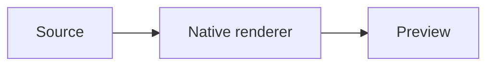

# From source to preview

These diagrams also have standalone source files beside this document.

```pikchr
box "Source"; arrow; box "Native renderer"; arrow; box "Preview"
```

```svgbob
+----------+      +-----------------+      +-----------+
| Source   +----->| Native renderer +----->| Preview   |
+----------+      +-----------------+      +-----------+
```



```lini
{ direction: row; gap: 44; padding: 16 }
|box#source| "Source" { fill: --sky-wash; stroke: --sky-ink; color: --sky-ink }
|box#renderer| "Native renderer" { fill: --teal-wash; stroke: --teal-ink; color: --teal-ink }
|box#preview| "Preview" { fill: --purple-wash; stroke: --purple-ink; color: --purple-ink }
source -> renderer
renderer -> preview
```


[Native equation examples](math.md) exercise inline/display math, matrices,
emphasis, lists, quotes, literal dollars and source diagnostics.

```d2
direction: right
vars: { d2-config: { pad: 24 } }
source: Source { style: { fill: "#d1f4fc"; stroke: "#00576a" } }
compiler: Compile + layout { style: { fill: "#cdf7f0"; stroke: "#006a61" } }
scene: Native scene { style: { fill: "#efe7ff"; stroke: "#573790" } }
preview: Preview { style: { fill: "#fff1d7"; stroke: "#935f0b" } }
source -> compiler -> scene -> preview
```

## A process without authored layout

```bpmn
<definitions xmlns="http://www.omg.org/spec/BPMN/20100524/MODEL" id="review_definition" targetNamespace="urn:example">
 <process id="review"><startEvent id="start"/><userTask id="task" name="Review order"/><endEvent id="end"/>
  <sequenceFlow id="first" sourceRef="start" targetRef="task"/><sequenceFlow id="last" sourceRef="task" targetRef="end"/>
 </process>
</definitions>
```

`order.bpmn` also demonstrates authored coordinates and namespace-qualified colors.
