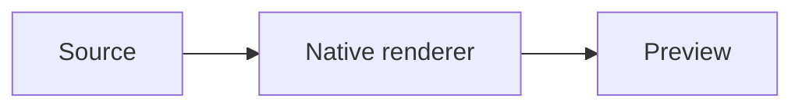

# From source to preview

These diagrams also have standalone source files beside this document.

```pikchr
box "Source"; arrow; box "Native renderer"; arrow; box "Preview"
```

```svgbob
+----------+      +-----------------+      +-----------+
| Source   +----->| Native renderer +----->| Preview   |
+----------+      +-----------------+      +-----------+
```



```lini
{ direction: row; gap: 44; padding: 16 }
|box#source| "Source" { fill: --sky-wash; stroke: --sky-ink; color: --sky-ink }
|box#renderer| "Native renderer" { fill: --teal-wash; stroke: --teal-ink; color: --teal-ink }
|box#preview| "Preview" { fill: --purple-wash; stroke: --purple-ink; color: --purple-ink }
source -> renderer
renderer -> preview
```
