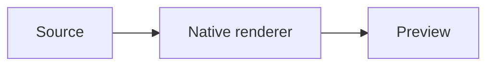

# From source to preview

These diagrams also have standalone source files beside this document.

[Harness overview](harness.md) embeds the neighboring `harness.wireviz` example:
quoted pin identities, reversed parallel wiring, striped conductors and a
single-ended cable shield.

```pikchr
box "Source"; arrow; box "Native renderer"; arrow; box "Preview"
```

```svgbob
+----------+      +-----------------+      +-----------+
| Source   +----->| Native renderer +----->| Preview   |
+----------+      +-----------------+      +-----------+
```



```lini
{ direction: row; gap: 44; padding: 16 }
|box#source| "Source" { fill: --sky-wash; stroke: --sky-ink; color: --sky-ink }
|box#renderer| "Native renderer" { fill: --teal-wash; stroke: --teal-ink; color: --teal-ink }
|box#preview| "Preview" { fill: --purple-wash; stroke: --purple-ink; color: --purple-ink }
source -> renderer
renderer -> preview
```


[Native equation examples](math.md) exercise inline/display math, matrices,
emphasis, lists, quotes, literal dollars and source diagnostics.

```d2
direction: right
vars: { d2-config: { pad: 24 } }
source: Source { style: { fill: "#d1f4fc"; stroke: "#00576a" } }
compiler: Compile + layout { style: { fill: "#cdf7f0"; stroke: "#006a61" } }
scene: Native scene { style: { fill: "#efe7ff"; stroke: "#573790" } }
preview: Preview { style: { fill: "#fff1d7"; stroke: "#935f0b" } }
source -> compiler -> scene -> preview
```

## A process without authored layout

```bpmn
<definitions xmlns="http://www.omg.org/spec/BPMN/20100524/MODEL" id="review_definition" targetNamespace="urn:example">
 <process id="review"><startEvent id="start"/><userTask id="task" name="Review order"/><endEvent id="end"/>
  <sequenceFlow id="first" sourceRef="start" targetRef="task"/><sequenceFlow id="last" sourceRef="task" targetRef="end"/>
 </process>
</definitions>
```

`order.bpmn` also demonstrates authored coordinates and namespace-qualified colors.

## Clipboard sources

Copy a complete raw diagram from one of these code blocks to preview it on the
little screen, then open the captured text to edit its source with a live preview.
Distinctive Mermaid/DOT/BPMN headers, quoted Pikchr shapes, Lini declarations,
D2 direction headers with edges and closed SvgBob boxes are recognized. Ambiguous
edge-only D2 stays text; use a `.d2` file or Markdown fence to select that syntax.
Incomplete or failed inferred renders stay readable text on the little screen.
Use Copy source to publish edits, or Save As to create a new file in an existing
directory. Original clipboard bytes are retained until explicitly edited.

## Digital timing

```wavedrom
{signal:[{name:'clock',wave:'p.......'},{name:'data',wave:'x3..4..x',data:['Address','Payload']}]}
```

`spi.json5` demonstrates grouped lanes, event arrows and a heading. JSON/JSON5
files need a distinctive WaveJSON structure; ordinary JSON stays text. Explicit
`.wavejson` and `.wavedrom` files select the renderer even while source is invalid.
Register (`reg`) and logic (`assign`) figures also render.

Timing files also have a direct signal-cell painter. Choose a state and click or
drag a lane; use Undo/Redo or Ctrl+Z/Ctrl+Shift+Z while the canvas is focused.
The source and rendered timing stay linked, including comments and unrelated
properties. Gaps/subcycles, adding lanes and editing bus labels/arcs still use
the highlighted source editor.

## UML compartments

[Nomnoml example](nomnoml.md) embeds `pipeline.nomnoml`. Both `.nomnoml` and
`.noml` open highlighted source with a live native preview. Classifiers,
compartments, nested diagrams and custom styles use the pinned upstream renderer
in the existing embedded interpreter. No browser or installed JavaScript runtime
is needed. Imports are refused visibly; mixed-script/custom-font layouts disclose
upstream estimated text metrics. Browser strips show the whole diagram height.

```nomnoml
#direction: right
[Source|+read()] -> [Worker|+render()]
[Worker] -> [Preview|+inspect()]
```

## Database schema

[DBML example](dbml.md) embeds `schema.dbml`. Tables, fields, enums, primary/index
keys and real column relationships use a native Rust parser and the existing
native Graphviz renderer. Expressions and defaults are inert text. `.dbml` files
open highlighted source/live preview; standalone strips show the whole schema.
Unsupported newer DBML constructs report errors, and metadata not drawn in the
initial diagram has visible limitations. Partials, records and optional relationship
operators remain compatibility work.

## GoAT ASCII and box drawing

[GoAT examples](goat.md) embed `pipeline.goat`. `unicode.goat` exercises the
separate upstream Unicode-box frontend. Both use the compiled, bundled GoAT
engine and native SVG/font/raster handling. Tabs are reported rather than
silently expanded; use spaces for the authored character grid. `.goat` files open
highlighted source/live preview with rendered list strips and hover popouts.
Building requires Go 1.25+; deployments keep the versioned companion executable.

### Bytefield

`packet.bytefield` and `bytefield.md` show a colored message header, related
bytes and a variable-length payload. The same source can use upstream's `.edn`
suffix; ordinary EDN maps are not classified as diagrams. Helpers, maps, loops
allowed by upstream's termination-safe preset and custom attributes remain part
of the original DSL. The source editor exposes errors and previews without
flattening helper-generated output into fabricated source calls.
