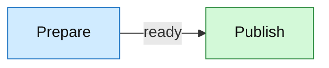
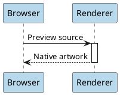

# Diagram review collection

Standalone files sit beside their Markdown examples. Rendering stays local; unsupported source/resources produce diagnostics.

Inline math $E=mc^2$ and display math:

$$
\sum_{k=1}^{n}k=\frac{n(n+1)}2
$$

## pikchr

[Standalone source](pipeline.pikchr)

```pikchr
box "Source"; arrow; box "Native renderer"; arrow; box "Preview"
```

## svgbob

[Standalone source](pipeline.svgbob)

```svgbob
+----------+      +-----------------+      +-----------+
| Source   +----->| Native renderer +----->| Preview   |
+----------+      +-----------------+      +-----------+
```

## mermaid

[Standalone source](mermaid-editor.mermaid)



## lini

[Standalone source](pipeline.lini)

```lini
{ direction: row; gap: 44; padding: 16 }
|box#source| "Source" { fill: --sky-wash; stroke: --sky-ink; color: --sky-ink }
|box#renderer| "Native renderer" { fill: --teal-wash; stroke: --teal-ink; color: --teal-ink }
|box#preview| "Preview" { fill: --purple-wash; stroke: --purple-ink; color: --purple-ink }
source -> renderer
renderer -> preview
```

## graphviz

[Standalone source](pipeline.gv)


## d2

[Standalone source](pipeline.d2)

```d2
direction: right
vars: { d2-config: { pad: 24 } }
source: Source { style: { fill: "#d1f4fc"; stroke: "#00576a" } }
compiler: Compile + layout { style: { fill: "#cdf7f0"; stroke: "#006a61" } }
scene: Native scene { style: { fill: "#efe7ff"; stroke: "#573790" } }
preview: Preview { style: { fill: "#fff1d7"; stroke: "#935f0b" } }
source -> compiler -> scene -> preview
```

## bpmn

[Standalone source](order.bpmn)

```bpmn
<?xml version="1.0" encoding="UTF-8"?>
<definitions xmlns="http://www.omg.org/spec/BPMN/20100524/MODEL"
 xmlns:layout="http://www.omg.org/spec/BPMN/20100524/DI"
 xmlns:dc="http://www.omg.org/spec/DD/20100524/DC"
 xmlns:di="http://www.omg.org/spec/DD/20100524/DI"
 xmlns:paint="http://bpmn.io/schema/bpmn/biocolor/1.0"
 id="order_definition" targetNamespace="urn:example:orders">
 <process id="order" isExecutable="false">
  <startEvent id="received" name="Order received"/>
  <userTask id="review" name="Review order"/>
  <exclusiveGateway id="approved" name="Approved?"/>
  <endEvent id="complete" name="Ready to ship"/>
  <sequenceFlow id="a" sourceRef="received" targetRef="review"/>
  <sequenceFlow id="b" sourceRef="review" targetRef="approved"/>
  <sequenceFlow id="c" sourceRef="approved" targetRef="complete" name="Yes"/>
 </process>
 <layout:BPMNDiagram id="diagram">
  <layout:BPMNPlane id="plane" bpmnElement="order">
   <layout:BPMNShape id="received_shape" bpmnElement="received">
    <dc:Bounds x="40" y="112" width="36" height="36"/>
   </layout:BPMNShape>
   <layout:BPMNShape id="review_shape" bpmnElement="review" paint:fill="#cceeff" paint:stroke="#286078">
    <dc:Bounds x="130" y="90" width="120" height="80"/>
   </layout:BPMNShape>
   <layout:BPMNShape id="approved_shape" bpmnElement="approved" paint:fill="#fff0b3">
    <dc:Bounds x="305" y="105" width="50" height="50"/>
   </layout:BPMNShape>
   <layout:BPMNShape id="complete_shape" bpmnElement="complete">
    <dc:Bounds x="420" y="112" width="36" height="36"/>
   </layout:BPMNShape>
   <layout:BPMNEdge id="a_edge" bpmnElement="a"><di:waypoint x="76" y="130"/><di:waypoint x="130" y="130"/></layout:BPMNEdge>
   <layout:BPMNEdge id="b_edge" bpmnElement="b"><di:waypoint x="250" y="130"/><di:waypoint x="305" y="130"/></layout:BPMNEdge>
   <layout:BPMNEdge id="c_edge" bpmnElement="c"><di:waypoint x="355" y="130"/><di:waypoint x="420" y="130"/></layout:BPMNEdge>
  </layout:BPMNPlane>
 </layout:BPMNDiagram>
</definitions>
```

## wavedrom

[Standalone source](spi.json5)

```wavedrom
{
  // Illustrative transfer; periods and phases remain numeric source values.
  signal: [
    {name: 'clock', wave: 'p.......'},
    ['Controller',
      {name: 'select_n', wave: '10.....1', node: '.a....b.'},
      {name: 'data', wave: 'x.345..x', data: ['Command', 'Address', 'Payload']},
    ],
    {name: 'ready', wave: '0...1.0.'},
  ],
  edge: ['a~>b Transfer'],
  head: {text: 'Serial transaction', tick: 0},
  config: {skin: 'default', hscale: 2},
}
```

## excalidraw

[Standalone source](drawing.excalidraw)

```excalidraw
{
  "type": "excalidraw",
  "version": 2,
  "source": "little-screen-clip",
  "elements": [
    {
      "angle": 0,
      "strokeColor": "#1e1e1e",
      "backgroundColor": "#d0ebff",
      "fillStyle": "solid",
      "strokeWidth": 1,
      "strokeStyle": "solid",
      "roughness": 1,
      "opacity": 100,
      "groupIds": [],
      "frameId": null,
      "roundness": {
        "type": 3
      },
      "seed": 17,
      "version": 1,
      "versionNonce": 1,
      "isDeleted": false,
      "boundElements": [
        {
          "id": "connection",
          "type": "arrow"
        },
        {
          "id": "capture-label",
          "type": "text"
        }
      ],
      "updated": 1,
      "link": null,
      "locked": false,
      "type": "rectangle",
      "id": "capture",
      "x": 0,
      "y": 40,
      "width": 180,
      "height": 110
    },
    {
      "angle": 0,
      "strokeColor": "#1e1e1e",
      "backgroundColor": "#d3f9d8",
      "fillStyle": "solid",
      "strokeWidth": 1,
      "strokeStyle": "solid",
      "roughness": 1,
      "opacity": 100,
      "groupIds": [],
      "frameId": null,
      "roundness": null,
      "seed": 17,
      "version": 1,
      "versionNonce": 1,
      "isDeleted": false,
      "boundElements": [
        {
          "id": "connection",
          "type": "arrow"
        },
        {
          "id": "explore-label",
          "type": "text"
        }
      ],
      "updated": 1,
      "link": null,
      "locked": false,
      "type": "ellipse",
      "id": "explore",
      "x": 300,
      "y": 40,
      "width": 180,
      "height": 110
    },
    {
      "angle": 0,
      "strokeColor": "#1e1e1e",
      "backgroundColor": "transparent",
      "fillStyle": "solid",
      "strokeWidth": 1,
      "strokeStyle": "solid",
      "roughness": 1,
      "opacity": 100,
      "groupIds": [],
      "frameId": null,
      "roundness": null,
      "seed": 17,
      "version": 1,
      "versionNonce": 1,
      "isDeleted": false,
      "boundElements": null,
      "updated": 1,
      "link": null,
      "locked": false,
      "type": "arrow",
      "id": "connection",
      "x": 182,
      "y": 95,
      "width": 116,
      "height": 0,
      "points": [
        [
          0,
          0
        ],
        [
          116,
          0
        ]
      ],
      "lastCommittedPoint": null,
      "startBinding": {
        "elementId": "capture",
        "focus": 0,
        "gap": 2
      },
      "endBinding": {
        "elementId": "explore",
        "focus": 0,
        "gap": 2
      },
      "startArrowhead": null,
      "endArrowhead": "arrow"
    },
    {
      "angle": 0,
      "strokeColor": "#1e1e1e",
      "backgroundColor": "transparent",
      "fillStyle": "solid",
      "strokeWidth": 1,
      "strokeStyle": "solid",
      "roughness": 1,
      "opacity": 100,
      "groupIds": [],
      "frameId": null,
      "roundness": null,
      "seed": 17,
      "version": 1,
      "versionNonce": 1,
      "isDeleted": false,
      "boundElements": null,
      "updated": 1,
      "link": null,
      "locked": false,
      "type": "text",
      "id": "capture-label",
      "x": 35,
      "y": 80,
      "width": 110,
      "height": 30,
      "fontSize": 24,
      "fontFamily": 5,
      "text": "Capture",
      "originalText": "Capture",
      "textAlign": "left",
      "verticalAlign": "top",
      "containerId": "capture",
      "autoResize": true,
      "lineHeight": 1.25
    },
    {
      "angle": 0,
      "strokeColor": "#1e1e1e",
      "backgroundColor": "transparent",
      "fillStyle": "solid",
      "strokeWidth": 1,
      "strokeStyle": "solid",
      "roughness": 1,
      "opacity": 100,
      "groupIds": [],
      "frameId": null,
      "roundness": null,
      "seed": 17,
      "version": 1,
      "versionNonce": 1,
      "isDeleted": false,
      "boundElements": null,
      "updated": 1,
      "link": null,
      "locked": false,
      "type": "text",
      "id": "explore-label",
      "x": 338,
      "y": 80,
      "width": 110,
      "height": 30,
      "fontSize": 24,
      "fontFamily": 5,
      "text": "Explore",
      "originalText": "Explore",
      "textAlign": "left",
      "verticalAlign": "top",
      "containerId": "explore",
      "autoResize": true,
      "lineHeight": 1.25
    },
    {
      "angle": 0,
      "strokeColor": "#1e1e1e",
      "backgroundColor": "transparent",
      "fillStyle": "solid",
      "strokeWidth": 1,
      "strokeStyle": "solid",
      "roughness": 1,
      "opacity": 100,
      "groupIds": [],
      "frameId": null,
      "roundness": null,
      "seed": 17,
      "version": 1,
      "versionNonce": 1,
      "isDeleted": false,
      "boundElements": null,
      "updated": 1,
      "link": null,
      "locked": false,
      "type": "text",
      "id": "caption",
      "x": 0,
      "y": 285,
      "width": 370,
      "height": 30,
      "fontSize": 24,
      "fontFamily": 5,
      "text": "Draw, inspect, and revise.",
      "originalText": "Draw, inspect, and revise.",
      "textAlign": "left",
      "verticalAlign": "top",
      "containerId": null,
      "autoResize": true,
      "lineHeight": 1.25
    },
    {
      "angle": 0,
      "strokeColor": "#e03131",
      "backgroundColor": "transparent",
      "fillStyle": "solid",
      "strokeWidth": 2,
      "strokeStyle": "solid",
      "roughness": 1,
      "opacity": 100,
      "groupIds": [],
      "frameId": null,
      "roundness": null,
      "seed": 17,
      "version": 1,
      "versionNonce": 1,
      "isDeleted": false,
      "boundElements": null,
      "updated": 1,
      "link": null,
      "locked": false,
      "type": "freedraw",
      "id": "stroke",
      "x": 0,
      "y": 205,
      "width": 150,
      "height": 45,
      "points": [
        [
          0,
          30
        ],
        [
          35,
          0
        ],
        [
          70,
          45
        ],
        [
          110,
          10
        ],
        [
          150,
          25
        ]
      ],
      "pressures": [],
      "simulatePressure": true,
      "lastCommittedPoint": null
    },
    {
      "angle": 0,
      "strokeColor": "#1e1e1e",
      "backgroundColor": "transparent",
      "fillStyle": "solid",
      "strokeWidth": 1,
      "strokeStyle": "solid",
      "roughness": 1,
      "opacity": 100,
      "groupIds": [],
      "frameId": null,
      "roundness": null,
      "seed": 17,
      "version": 1,
      "versionNonce": 1,
      "isDeleted": false,
      "boundElements": null,
      "updated": 1,
      "link": null,
      "locked": false,
      "type": "image",
      "id": "embedded-image",
      "x": 330,
      "y": 185,
      "width": 128,
      "height": 96,
      "fileId": "gradient",
      "status": "saved",
      "scale": [
        1,
        1
      ],
      "crop": null
    }
  ],
  "appState": {
    "viewBackgroundColor": "#ffffff",
    "gridSize": 20
  },
  "files": {
    "gradient": {
      "id": "gradient",
      "mimeType": "image/png",
      "dataURL": "data:image/png;base64,iVBORw0KGgoAAAANSUhEUgAAACAAAAAYCAIAAAAUMWhjAAAAN0lEQVR4nGOUC5jGysBAO8QCImgJWEYtIARGg4ggGA0igmA0iAiC0SAiCEaDiCAYDSKCgOZBBABdSQJwJ5oL0QAAAABJRU5ErkJggg==",
      "created": 1,
      "lastRetrieved": 1
    }
  }
}
```

## wireviz

[Standalone source](harness-presentation.wireviz)

```wireviz
# Native palette and visibility example; untouched source remains authoritative.
connectors:
  INPUT:
    pincolors: [RD, BU, GN, YE, BK]
    pinlabels: [SIGNAL_A, SIGNAL_B, LOOP_A, LOOP_B, SPARE]
    hide_disconnected_pins: true
    loops: [[3, 4]]
    bgcolor_title: '#174f68'
  OUTPUT:
    pincount: 4
    pinlabels: [SIGNAL_A, SIGNAL_B, RETURN_A, RETURN_B]
  SPLICE_A:
    style: simple
    type: Splice A
  SPLICE_B:
    style: simple
    type: Splice B
cables:
  CABLE:
    wirecount: 8
    color_code: T568B
    show_wirenumbers: false
  BUNDLE:
    wirecount: 2
    category: bundle
    color_code: BW
    bgcolor_title: '#5a365d'
options:
  bgcolor: WH
  bgcolor_node: '#f4f7fa'
  bgcolor_bundle: '#eee8f2'
connections:
  - - INPUT: [1, 2]
    - CABLE: [1, 2]
    - OUTPUT: [1, 2]
  - - OUTPUT: [3, 4]
    - BUNDLE: [1, 2]
    - [SPLICE_A, SPLICE_B]
```

## nomnoml

[Standalone source](pipeline.nomnoml)

```nomnoml
// A small preview pipeline.
#direction: right
#fill: #90ee90
[Source|+read()] -> [Worker|+render()]
[Worker] -> [Preview|+inspect()]
```

## dbml

[Standalone source](modern-schema.dbml)

```dbml
TablePartial identity {
  id int [pk]
  name varchar(50)
}

TablePartial audit {
  created_at timestamp
}

Enum State {
  active
  inactive
}

Table users {
  ~identity
  ~audit
  name varchar(100) [not null]
  state State

  records [example] {
    1, '2024-01-15', 'Alice, O\'Brien', State.active
    2, `now()`, 'Bob', 'inactive'
  }
}

Table posts {
  id int [pk]
  author_id int [ref: >? users.id]
  title varchar
}

records posts(id, author_id, title) [example] {
  10, 1, 'A post with an author'
  11, , 'A post without an author'
}
```

## goat

[Standalone source](pipeline.goat)

```goat
    .--------.     .--------.     .---------.
o-->| Source +---->| Render +---->| Preview +--*
    '--------'     '--------'     '---------'
```

## bytefield

[Standalone source](packet.bytefield)

```bytefield
;; Bytefield preview: a small message header with variable payload.
(def boxes-per-row 8)
(defattrs :header {:fill "#b8d8ec"})
(draw-column-headers)
(draw-box "Type" [:header {:span 2}])
(draw-box "Flags" [:header {:span 2}])
(draw-box "Length" [:header {:span 4}])
(draw-related-boxes [0x01 0x00 0x00 0x08 0x41 0x42 0x43 0x44])
(draw-gap "Payload")
(draw-bottom)
```

## erd

[Standalone source](people.er)

```erd
# A compact Erd schema with primary/foreign keys and exact cardinalities.
title {label: "People and places", size: "18"}
entity {bgcolor: "#d0e0d0"}
[Person]
*id {label: "integer"}
name {label: "text"}
+birth_place_id
[Place] {bgcolor: "#ececfc"}
*id
city
Person *--1 Place {label: "born in"}
```

## plantuml

[Standalone source](sequence.puml)



## c4plantuml

[Standalone source](architecture.puml)

```c4plantuml
@startuml
!include <C4/C4_Container>
Person(reader, "Reader", "Explores local files")
System(browser, "File manager", "Interactive previews")
Rel(reader, browser, "Browses")
@enduml
```

## drawio

[Standalone source](pipeline.drawio)

```drawio
<mxfile><diagram id="p1" name="Preview"><mxGraphModel><root>
<mxCell id="0"/><mxCell id="1" parent="0"/>
<mxCell id="a" value="Source" style="rounded=1;whiteSpace=wrap;html=1;fillColor=#dae8fc;strokeColor=#6c8ebf;" vertex="1" parent="1"><mxGeometry x="20" y="20" width="120" height="60" as="geometry"/></mxCell>
<mxCell id="b" value="Preview" style="ellipse;whiteSpace=wrap;html=1;fillColor=#d5e8d4;" vertex="1" parent="1"><mxGeometry x="240" y="20" width="120" height="60" as="geometry"/></mxCell>
<mxCell id="edge" value="renders" style="edgeStyle=orthogonalEdgeStyle;endArrow=block;html=1;" edge="1" source="a" target="b" parent="1"><mxGeometry relative="1" as="geometry"/></mxCell>
</root></mxGraphModel></diagram></mxfile>
```

## structurizr

[Standalone source](deployment.structurizr)

```structurizr
workspace "Placement review" {
    model {
        shop = softwareSystem "Shop" {
            api = container "API" "Accepts requests" "Rust"
            db = container "Database" "Stores orders" "PostgreSQL"
        }
        api -> db "Queries" "SQL"
        prod = deploymentEnvironment "Production" {
            region = deploymentNode "Cloud region" "Selected production placement" "Region" {
                gateway = infrastructureNode "Gateway" "Routes requests" "TLS"
                hostA = deploymentNode "Host A" "Application host" "Linux" { apiA = containerInstance api }
                hostB = deploymentNode "Host B" "Application and storage host" "Linux" {
                    apiB = containerInstance api
                    database = containerInstance db
                }
                gateway -> apiA "Routes" "HTTPS"
                apiA -> apiA "Health" "Local"
            }
        }
    }
    views {
        deployment shop prod "Production" { include * autoLayout lr }
        styles {
            element "Deployment Node" { background "#edf1f5" color "#26354a" stroke "#61758d" }
            element "Container" { background "#295f98" color "#ffffff" }
            element "Infrastructure Node" { background "#f3dfc0" color "#26354a" }
            relationship "Relationship" { color "#a91f72" routing Orthogonal }
        }
    }
}
```

## blockdiag

[Standalone source](pipeline.blockdiag)

```blockdiag
blockdiag {
  default_fontsize = 16;
  node_width = 140;
  node_height = 60;
  source [label = "Source", color = "#d9e8fb"];
  parse [label = "Parse", shape = roundedbox];
  preview [label = "Preview", color = "#d9f0df"];
  source -> parse -> preview;
  group validation {
    label = "Validation";
    color = "#eeeeee";
    parse;
    rejected [label = "Error", shape = diamond, color = "#f7ddd8"];
  }
  parse -> rejected [label = "invalid", style = dashed];
}
```

## seqdiag

[Standalone source](request.seqdiag)

```seqdiag
seqdiag {
  default_fontsize = 14;
  browser [color = "#d9e8fb"];
  browser -> service [label = "GET /preview"];
  service -> cache [label = "Find source"];
  service <-- cache [label = "Cached diagram"];
  browser <-- service [label = "SVG preview"];
}
```

## actdiag

[Standalone source](review.actdiag)

```actdiag
actdiag {
  draft -> review -> publish;
  draft [label = "Draft"];
  review [label = "Review", color = "#d9e8fb"];
  publish [label = "Publish", color = "#d9f0df"];
  lane author {
    label = "Author";
    draft;
    publish;
  }
  lane editor {
    label = "Editor";
    review;
  }
}
```

## nwdiag

[Standalone source](service.nwdiag)

```nwdiag
nwdiag {
  network public {
    address = "192.0.2.0/24";
    gateway [address = "192.0.2.1"];
    web [address = "192.0.2.20", color = "#d9e8fb"];
  }
  network internal {
    address = "10.0.0.0/24";
    web [address = "10.0.0.20"];
    database [address = "10.0.0.30", color = "#d9f0df"];
  }
}
```

## packetdiag

[Standalone source](header.packetdiag)

```packetdiag
packetdiag {
  colwidth = 32;
  node_height = 64;
  0-3: Version [color = "#d9e8fb"];
  4-7: Flags;
  8-15: Length [color = "#d9f0df"];
  16-31: Identifier;
  32-63: Payload;
}
```

## rackdiag

[Standalone source](server.rackdiag)

```rackdiag
rackdiag {
  rack {
    12U;
    description = "Preview rack";
    1: Switch [color = "#d9e8fb"];
    3: Render [2U, color = "#d9f0df"];
    6: Storage [3U];
    10: Backup [2U, color = "#d9f0df"];
  }
}
```

## ditaa

[Standalone source](pipeline.ditaa)

```ditaa
+------------+     +------------+     +------------+
| Source     |---->| Local      |---->| Preview    |
| cBLU {d}   |     | Ditaa      |     | cGRE       |
+------+-----+     +------------+     +------------+
       :                                    ^
       |         bounded SVG output         |
       +------------------------------------+
```

## tikz

[Standalone source](native-tikz.tikz)

```tikz
\usetikzlibrary{arrows.meta,positioning,calc}
\definecolor{stageblue}{HTML}{295F98}
\definecolor{stagegold}{HTML}{DA9B42}
\def\radius{0.15}
\begin{tikzpicture}[>=Stealth,thick]
  \node[draw=stageblue,fill=stageblue!10,rounded corners,minimum width=2.3cm,minimum height=0.9cm] (source) at (0,0) {Source};
  \node[draw=stageblue,fill=stageblue!10,rounded corners,minimum width=2.3cm,minimum height=0.9cm] (layout) at (3.5,0) {Native layout};
  \node[draw=stagegold,fill=stagegold!15,rounded corners,minimum width=2.3cm,minimum height=0.9cm] (preview) at (7,0) {Preview};
  \draw[->,stageblue] (source) -- (layout);
  \draw[->,stageblue] (layout) -- (preview);
  \draw[->,stagegold,bend left=28] (preview.south) to node[below] {$x^2+y^2=r^2$} (source.south);
  \begin{scope}[shift={(2,-2)}]
    \foreach \x in {0,1,2,3} {
      \fill[stagegold] (\x,0) circle (\radius);
    }
    \draw[stageblue] (0,0) .. controls (1,1) and (2,-1) .. (3,0);
  \end{scope}
\end{tikzpicture}
```

## pgf

[Standalone source](native-pgf.pgf)

```pgf
\definecolor{stageblue}{HTML}{295F98}
\definecolor{stagegold}{HTML}{DA9B42}
\begin{pgfpicture}
  \pgfsetlinewidth{1.2pt}
  \pgfsetstrokecolor{stageblue}
  \pgfsetfillcolor{stageblue!10}
  \pgfpathrectangle{\pgfpoint{0cm}{0cm}}{\pgfpoint{6cm}{2cm}}
  \pgfusepath{fill,stroke}
  \pgfsetstrokecolor{stagegold}
  \pgfpathmoveto{\pgfpoint{0.5cm}{0.5cm}}
  \pgfpathcurveto{\pgfpoint{2cm}{2cm}}{\pgfpoint{4cm}{0cm}}{\pgfpoint{5.5cm}{1.5cm}}
  \pgfusepath{stroke}
  \pgfsetfillcolor{black}
  \pgftext[at={\pgfpoint{3cm}{1cm}}]{PGF paths and $\int_0^1 x\,dx$}
\end{pgfpicture}
```

## pgfplots

[Standalone source](native-pgfplots.pgfplots)

```pgfplots
\begin{tikzpicture}
\begin{axis}[
  width=10cm,height=6cm,
  xlabel={$x$},ylabel={Value},
  xmin=0,xmax=3,ymin=0,ymax=10,
  grid=major,legend pos=north west
]
  \addplot[blue,thick,domain=0:3,samples=41] {x*x};
  \addlegendentry{$x^2$}
  \addplot[orange,thick,mark=*] table[row sep=\\] {
    x y\\
    0 1\\
    1 2\\
    2 3\\
    3 4\\
  };
  \addlegendentry{Inline observations}
\end{axis}
\end{tikzpicture}
```

## umlet

[Standalone source](umlet/class-relations.uxf)

```umlet
<?xml version="1.0" encoding="UTF-8"?>
<diagram program="umlet" version="15.1">
  <zoom_level>10</zoom_level>
  <element>
    <id>UMLClass</id>
    <coordinates><x>40</x><y>40</y><w>180</w><h>120</h></coordinates>
    <panel_attributes>FileSource
--
-revision: Identity
--
+read(): Bytes
bg=#e8f1ff</panel_attributes>
    <additional_attributes/>
  </element>
  <element>
    <id>UMLClass</id>
    <coordinates><x>360</x><y>40</y><w>180</w><h>120</h></coordinates>
    <panel_attributes>Preview
--
-geometry: Scene
--
+render(): Image
bg=#e7f7ed</panel_attributes>
    <additional_attributes/>
  </element>
  <element>
    <id>Relation</id>
    <coordinates><x>210</x><y>70</y><w>170</w><h>50</h></coordinates>
    <panel_attributes>lt=-&gt;
m1=1
m2=*
supplies</panel_attributes>
    <additional_attributes>10;20;150;20</additional_attributes>
  </element>
  <element>
    <id>UMLNote</id>
    <coordinates><x>40</x><y>220</y><w>230</w><h>80</h></coordinates>
    <panel_attributes>Source and geometry
stay locally editable.
bg=yellow</panel_attributes>
    <additional_attributes/>
  </element>
  <element>
    <id>UMLActor</id>
    <coordinates><x>360</x><y>210</y><w>80</w><h>110</h></coordinates>
    <panel_attributes>Reader</panel_attributes>
    <additional_attributes/>
  </element>
  <element>
    <id>UMLUseCase</id>
    <coordinates><x>500</x><y>230</y><w>160</w><h>60</h></coordinates>
    <panel_attributes>Inspect a diagram</panel_attributes>
    <additional_attributes/>
  </element>
</diagram>
```

## vega

[Standalone source](native-vega.vega.json)

```vega
{
  "$schema": "https://vega.github.io/schema/vega/v6.json",
  "description": "Canonical Vega: inline data, formula, band/linear scales and native SVG marks.",
  "background": "white",
  "width": 440,
  "height": 240,
  "padding": 12,
  "title": "Local preview throughput",
  "data": [{"name": "table", "values": [
    {"stage": "Parse", "ms": 8}, {"stage": "Layout", "ms": 23}, {"stage": "Raster", "ms": 15}
  ], "transform": [{"type": "formula", "expr": "datum.ms * 2", "as": "budget"}]}],
  "scales": [
    {"name": "x", "type": "band", "domain": {"data": "table", "field": "stage"}, "range": "width", "padding": 0.25},
    {"name": "y", "type": "linear", "domain": {"data": "table", "field": "budget"}, "range": "height", "nice": true, "zero": true}
  ],
  "axes": [{"orient": "bottom", "scale": "x"}, {"orient": "left", "scale": "y", "title": "Budget (ms)"}],
  "marks": [{"type": "rect", "from": {"data": "table"}, "encode": {"enter": {
    "x": {"scale": "x", "field": "stage"}, "width": {"scale": "x", "band": 1},
    "y": {"scale": "y", "field": "budget"}, "y2": {"scale": "y", "value": 0}, "fill": {"value": "#295f98"}
  }}}]
}
```

## vegalite

[Standalone source](native-vega-lite.vl.json)

```vegalite
{
  "$schema": "https://vega.github.io/schema/vega-lite/v6.json",
  "description": "Canonical Vega-Lite: inline observations, aggregate encoding and color legend.",
  "title": "Latency by renderer",
  "width": 440,
  "height": 240,
  "data": {"values": [
    {"renderer": "SVG", "latency": 12, "phase": "First"},
    {"renderer": "SVG", "latency": 10, "phase": "First"},
    {"renderer": "Raster", "latency": 18, "phase": "First"},
    {"renderer": "SVG", "latency": 5, "phase": "Cached"},
    {"renderer": "Raster", "latency": 7, "phase": "Cached"}
  ]},
  "mark": {"type": "bar", "cornerRadiusTopLeft": 4, "cornerRadiusTopRight": 4},
  "encoding": {
    "x": {"field": "renderer", "type": "nominal", "title": "Renderer"},
    "xOffset": {"field": "phase"},
    "y": {"aggregate": "mean", "field": "latency", "type": "quantitative", "title": "Mean latency (ms)"},
    "color": {"field": "phase", "type": "nominal", "scale": {"range": ["#295f98", "#da9b42"]}}
  }
}
```

## symbolator

[Standalone source](entity.symbolator.vhdl)

```symbolator
library ieee;
use ieee.std_logic_1164.all;

entity sample_counter is
  generic (
    WIDTH : positive := 8
  );
  port (
    --# {{clocks|Clock}}
    clk : in std_logic;
    --# {{control|Control}}
    reset_n : in std_logic;
    enable : in std_logic;
    --# {{data|Data}}
    count : out std_logic_vector(WIDTH-1 downto 0);
    bus_io : inout std_logic_vector(3 downto 0)
  );
end entity sample_counter;
```
