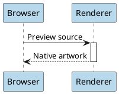

# Native diagrams



```c4plantuml
@startuml
!include <C4/C4_Container>
Person(reader, "Reader", "Explores local files")
System(browser, "File manager", "Interactive previews")
Rel(reader, browser, "Browses")
@enduml
```
