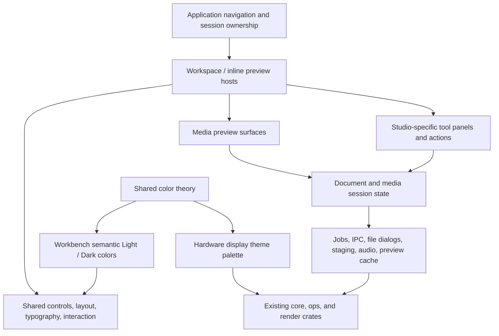

# Workbench UI overhaul: audit and implementation plan

Status: implementation underway on `feat/workbench-ui-overhaul`. The audit below records the original baseline; the code remains the source of truth for completed work.

Reviewed against commit `36e609847d99141e42764a602f748a36eee25e74` on 2026-09-22 (America/Chicago). This is a source audit, not a live visual or interaction test. Findings marked as risks need reproduction during the baseline phase. This proposal supersedes the old `ui_architecture_design.md` as a planning reference; that document describes some changes already implemented and some abstractions that remain unused.

Implemented first: focused-output sizing before the fixed popup maps, shared readable text and control dimensions, aligned studio/audio controls, compact Image Studio tool navigation, non-overlapping shared panel geometry, header wrapping, and corrected translucent-color contrast math. Film Look and Creative FX still use independent panel layout code; the remaining stages below are pending.

## 1. Recommended direction

Rebuild the workbench's presentation foundation and migrate every surface onto it. Preserve its media operations, clipboard behavior, editing semantics, external applications, and hardware integration. The overhaul is substantial: replacing sizing and color contracts, untangling preview content from studio chrome, and moving blocking work out of rendering are necessary parts of the work.

The result should feel like a precise, friendly instrument: readable labels, calm surfaces, purposeful color, tactile controls, and generous working space. It should support ordinary landscape laptops, 16:10 displays, 4K with different scale factors, and ultrawide monitors without shrinking the text to fit.

Primary decisions:

- Use one typography and control geometry system across all views. Button importance changes color and emphasis, not font size or height.
- Keep the workbench a non-resizable popup for Niri. Determine its screen-relative size before opening on every invocation; base internal layouts on the resulting logical space.
- Give the workbench two designed color modes, Light and Dark. Retain the color-theory machinery and separately preserve hardware display themes.
- Evolve `StudioShell` into a host that actually owns layout, focus, overlays, and status. Keep specialized image, timeline, table, and comparison bodies.
- Separate document/session state, preview rendering, editing controls, and application services so previews can be embedded in a future file manager.
- Prefer an egui upgrade followed by a bounded `egui_taffy` layout trial. Reuse the existing background executor; do not add three libraries merely because they are available.
- Keep existing features through a written parity matrix and executable interaction scenarios. Deleting awkward controls is not a substitute for redesigning them.

## 2. What the code says today

### Scale and structural baseline

`crates/clip-workbench/src` contains 51 Rust files and 47,717 physical lines, including tests. A textual inventory found 221 `.small()` calls across 26 files, 70 `egui::Button::` references across 20 files, and 539 direct `palette.theme.*` accesses across 40 files. These are migration inventories, not automatic defect counts; media pixels, exported images, test fixtures, and texture tint constants need different treatment from UI chrome.

The architecture measurement reports 6.46% duplication: 3,080 duplicated lines and 312 detected clone groups. It reports 52 high-complexity functions. The largest reported hotspots include the audio waveform renderer, Creative FX workspace, image `render_ui`, audio inspect UI, and application `update`. Rust closures can confuse function-boundary metrics, so use these results to direct inspection rather than as precise quality scores. No source was changed to establish these measurements.

### Findings and required changes

| Priority | Evidence in current source | Consequence and overhaul requirement |
| --- | --- | --- |
| P0 | `main.rs:2636` requests 1180×680 and explicitly sets `with_resizable(false)`, with dialog window type. | Preserve non-resizability: it is required for Niri popup behavior. Replace only the universal initial dimensions with screen-relative dimensions computed before the window opens; preserve separate sizing for the small prompt window. |
| P0 | `ui_ext.rs:100,156,204` makes tabs, secondary actions, and danger actions small; primary actions use normal text. Icons also vary between 13, 14, and 15. | Shared helpers encode inconsistent sizing. Replace their contracts, including input, checkbox, combo-box, slider, tab, and icon-button geometry. |
| P0 | `audio_preview/tools/hf_analysis.rs:325` mixes 30-point transport wrappers, raw mode buttons, a free-standing Mode label, and another toggle wrapper. | Direct explanation of the HF toolbar inconsistency. Use an aligned transport row and labeled segmented groups sharing one control height. |
| P0 | `shell/studio_shell.rs:310` puts titles, badges, external apps, actions, and Close in one horizontal row. External button widths follow their labels. | Headers have no overflow policy. Measure groups, normalize sibling external-app widths, move secondary metadata/actions to controlled overflow, and keep the document title usable. |
| P0 | `image_preview.rs:1334` puts 16 tool buttons plus zoom controls in a non-wrapping horizontal row. Palette is additionally reached through Pick Color. | Enlarging text alone makes this worse. Introduce grouped tool navigation with every tool discoverable and the active tool always visible. |
| P0 | `shell/studio_shell.rs:115` independently allocates fixed left/right rails and reverses center bounds using min/max when space is exhausted. | It has no minimum useful canvas width; at insufficient widths rails/center can overlap rather than reflow. Replace with a constraint-based layout decision. |
| P0 | `ui_ext.rs:14` composites translucent fills over an assumed `b_low`; `Color32` stores premultiplied channels, but the helper multiplies them by alpha again. Its tests repeat that calculation. | Existing contrast guarantees do not establish rendered contrast. Correct compositing against actual surfaces and test independently calculated results and actual widget states. |
| P0 | HF mode buttons explicitly use white/black foregrounds; many labels bypass contrast helpers; syntax colors are mapped directly to harmonies. | Cover text, icons, selected states, charts, syntax, search highlights, and custom-painted controls in both modes. |
| P1 | `main.rs:652` applies `renderer.palette` to the workbench; the theme picker mutates display config and reloads the daemon. `AppPalette` mixes slot-card and desktop concerns. | Separate workbench appearance from hardware display styling, sharing color math rather than the entire palette. |
| P1 | `main.rs:191,1558` owns multiple independent optional viewers and repeats full-screen dispatch. Each view couples loading/state, chrome, shortcuts, and content rendering. | Introduce explicit navigation/session ownership and embeddable preview surfaces. Preserve return destinations and existing launch modes. |
| P1 | `render_view_header`, `StudioShell::render_panels`, `ScreenMirrorWidget`, and `ShortcutDispatcher::handle_escape` have no call sites beyond their definitions/re-exports in this audit. | Existing abstractions are only partly adopted. Migrate to one working path and remove unused alternatives once their behavior is covered. |
| P1 | `PanelState` is serializable but has no application persistence wiring; image tools commonly allocate a fresh default layout. | Implement actual resize handles, collapse controls, restore behavior, and per-workspace preferences. |
| P1 | `main.rs:776` sizes the hardware mirror height solely from full available width. | Maximizing on ultrawide can consume excessive vertical space. Keep its genuine aspect ratio but cap its height, and provide compact/collapsed clipboard presentation. |
| P1 | Image input handling runs global Undo/Enter/Escape checks; its save fallback is an `egui::Window` rendered before those checks. MIDI uses global playback keys; binary diff uses Tab to switch modes. | Focus and overlays need explicit input ownership. Prevent editing a field or closing a dialog from also mutating/closing the studio. Preserve shortcuts contextually and restore ordinary focus traversal. |
| P1 | Quick Palette calls `response.request_focus()` on its search field every frame outside the audio-region case. | Repeated autofocus can defeat focus traversal and other controls. Request focus on entering the palette or an explicit Find/Search action, then respect the user's focus changes. |
| P1 | `main.rs:1716` synchronously opens several file types; `image_preview.rs:704` saves after a dialog result on the UI thread; `rolling_audio_strip.rs:173` performs IPC, decoding, and peak construction synchronously. | File opening, saving, and refresh can stall interaction. Move work through shared task/session handling and display honest progress/errors. |
| P1 | `spreadsheet_view.rs:223` filters rows and estimates column widths each render; its body traverses all visible rows/cells. | Cache query/measurement results, use measured text widths, and virtualize large tables. Essential groundwork for future file lists. |
| P1 | Text rendering uses 12.5-point code, fixed 18-point row heights, and fixed-row virtualization while also supporting line wrap. Binary layouts hardcode size tuples; MIDI labels include 9-point text. | Derive metrics from actual fonts. Verify wrapped-line measurement, scrolling, minimaps, search jumps, and hit testing at all scales. |
| P2 | `StatusToast` has several render paths and raw tuple adapters; failures can receive success-like styling and disappear on timers. Time sources vary between wall clock and egui time. | One typed notification/status presentation, monotonic timing, persistent actionable errors, and consistent loading/empty/missing-tool states. |
| P2 | Image external-app `EscapeHatch::new` calls place descriptive text in the command argument and leave tooltips empty, while launch is handled separately by index. | Use one typed action descriptor for label, executable, tooltip, availability, and launch intent; remove parallel metadata that can disagree. |

### Useful foundations to retain

- `StudioShell`, `PanelState`, and the existing per-image-tool layout mapping provide migration anchors.
- `SplitCompareView` is already reused by image tools; preserve and improve it rather than rediscovering the split-slider abstraction.
- Existing SVG icons, common zoom actions, external launcher, and shared audio sink are useful. Normalize their presentation and ownership.
- Core `Oklab`, `Oklch`, `DerivedHarmonies`, contrast math, media models, waveform/analysis helpers, PDF helpers, and format detection should remain shared.
- `BackgroundJobs` already provides a bounded worker queue, revision tickets, and completion receivers. `CommandRequest` bounds external command output and time; `ArtifactStore` manages staging lifetimes. Build on these.
- Binary diff already virtualizes rows; text has virtualization and minimap work worth preserving. Expand correctness and reuse instead of replacing working algorithms wholesale.
- The old design document's claims that most viewers lack `StudioShell` or external launchers are obsolete. Dynamic mirror slot geometry already reuses the renderer's slot layout.

## 3. Visual and interaction language

### Personality with a purpose

Use warm neutral surfaces in light mode and charcoal surfaces in dark mode. Introduce a restrained family of mint, sky, apricot, and lilac accents derived through the existing perceptual color model. Their exact values are design work, contingent on contrast checks; this plan does not prescribe untested hex colors.

Take instrument-panel organization, clearly grouped functions, useful scale ticks, and immediate feedback from analog gear/Teenage Engineering. Take confident shape and color relationships from Kurzgesagt. Use retro-console influence in technical readouts and information alignment, not in tiny bitmap body fonts. Mix modestly rounded controls and cards with squared editing canvases, grids, and aligned numeric displays.

Neumorphic influence should be limited to a subtle inset or raised edge that clarifies an interactive surface. Every control must still work visually without its shadow. No ornamental screws, fake meters, scanlines, simulated wear, nonfunctional switches, or animation that delays input.

Typography establishes hierarchy before color. Use one highly legible proportional UI family and a compatible monospace family for code, bytes, time, coordinates, and measured values. Keep existing vector icon vocabulary, normalize stroke/optical size, and replace functional emoji with predictable icons where appropriate.

### Initial typography and geometry contract

These are starting design tokens in egui logical points, not physical screen pixels. Verify on real displays before freezing them.

| Token | Initial value/behavior |
| --- | --- |
| Body and control label | 16 pt; regular labels, restrained emphasis |
| Secondary metadata/help | 14 pt minimum; important instructions/errors use body size |
| Code and numeric readouts | 15–16 pt; line/column metrics measured from the selected font |
| Section title | 18 pt |
| View title | 22 pt, with controlled truncation and access to the full title/path |
| Standard control height | Approximately 2.25 body em (36 pt at baseline), derived from font height plus padding |
| Compact rows | Approximately 2 em; same readable text, less padding; limited to genuinely dense tables/inspectors |
| Icon | Approximately 1.125 body em; icon-only hit area uses the standard control box |
| Spacing scale | 0.25, 0.5, 0.75, 1, and 1.5 body em |
| Corners | Square media/data canvases; small-radius inputs; moderately rounded controls/cards |

Expose a persistent UI scale preference. Respect native DPI and compositor scaling, then apply the user's app scale once. Keep content zoom separate: enlarging text must not change image pixel semantics, waveform time, or 3D camera state. Do not shrink text at layout breakpoints.

Remove `.small()` from ordinary workbench chrome. Any remaining reduced text needs a named semantic style and a justified use. Plot labels use readable styles and reduced tick density when crowded, rather than progressively smaller text.

Buttons share height, baseline, icon placement, focus treatment, and padding. Sibling choices such as Krita/Inkscape/Nomacs get equal widths based on the widest measured label. Segmented choices use equal cell widths within their group. Unrelated actions may use content widths; consistency does not mean giving every button in the app the same width. Reserve stable widths for Play/Pause and ON/OFF changes so playback cannot move neighboring controls.

Inputs, selectors, toggles, numeric entries, and reset controls align to those same rows. Sliders should provide a usable track, a precise editable value with units, clear limits/default, keyboard control, and a discoverable reset. Preserve the current default ticks/reset behavior while removing redundant-looking track presentation where it does not convey additional information.

Allow short color/hover transitions around 60–100 ms; apply actions immediately and keep focus changes immediate. Reduced motion disables decorative transitions. Loading indicators reflect actual work and never impose a minimum waiting interval.

## 4. Responsive desktop behavior

### Window sizing and coordinate systems

The main workbench remains a **non-resizable popup**, sized dynamically **before opening** on each invocation. Do not add maximize behavior, user-resized geometry restoration, or an initial small window that visibly grows after mapping. Niri documents automatic floating for fixed-size windows; that is an intentional integration contract, not a defect. Here, popup means a floating application toplevel, not a Wayland `xdg_popup` menu surface. [Niri floating-window behavior](https://niri-wm.github.io/niri/Floating-Windows.html)

Preferred startup path, without involving `little-clipd`:

1. Immediately before native window creation, query Niri's `FocusedOutput` through its IPC socket (`NIRI_SOCKET`). The equivalent diagnostic command is `niri msg --json focused-output`; it was successfully checked read-only in the current session. Put discovery in the workbench startup path so direct binary launches and all launch modes work, not only `launch.sh`.
2. Read the output's `logical.width`, `logical.height`, and scale. These dimensions are already compositor-logical; do not divide them by output scale again. Use the focused output rather than a hardcoded connector, primary monitor, or combined-desktop bounds. [Focused-output request](https://docs.rs/niri-ipc/26.4.0/niri_ipc/enum.Request.html), [logical output dimensions](https://docs.rs/niri-ipc/26.4.0/niri_ipc/struct.LogicalOutput.html)
3. Apply the shared screen-margin policy, initially roughly 92% of usable width and height, accounting for window chrome and known reserved insets. This is near 7:4 on 16:9, taller on 16:10, and wider on ultrawide. Never enforce 7:4 as a window aspect ratio. The reviewed output API exposes full logical output dimensions, **not an exact usable-work-area rectangle**; ordinary margin allowance is the initial fallback, with explicit inset support if needed. Do not claim panel/dock reservations are known from the output query.
4. Supply the computed initial client size and non-resizable state before the first surface is mapped. Ensure native minimum and maximum size hints agree with that size before Niri classifies the window. The current winit Wayland backend implements non-resizability by matching those hints; verify this behavior after the egui upgrade. Disable maximize affordances and prevent persisted eframe geometry from overriding the computed size.
5. Verify startup coordinate conversion in the selected eframe/winit version. The current egui-winit code initially estimates DPI from the primary/first monitor, which may differ from the focused output. Use the native window-creation hook if needed to supply correct logical sizing and fixed hints before mapping, and ensure later viewport application does not overwrite them with a differently scaled size. App UI scale affects content density, not the chosen screen footprint. No post-visible size correction is an acceptable substitute for correct startup.
6. Open once at the chosen size and keep the outer size fixed for that invocation. Recompute for the next invocation, including after monitor or scale changes. Internal panels can still resize/collapse. Handle compositor-enforced geometry changes defensively without turning the application into a user-resizable window.

Use a short bounded read-only discovery request, preferably typed `niri-ipc` over the socket. A CLI query is adequate for the feasibility spike; avoid a persistent watcher just for launch sizing. Handle null/disconnected output, timeout, or unavailable IPC explicitly: use a supported backend's pre-window monitor discovery where available, with a documented conservative fixed-size recovery fallback. Never block startup indefinitely or open a temporary visible probe window. No daemon change is required for the normal Niri path; daemon involvement is a fallback only if the feasibility phase establishes a real missing capability.

Niri owns final placement. Query close to creation and test focus changes/hotplug between discovery and mapping; do not assume a read-only output query atomically pins where a later Wayland window opens. Do not rewrite compositor rules or perform a visible post-open move/resize as the normal solution. Retain the existing app ID and separate prompt-window behavior.

Use logical points and font-relative tokens for UI. Physical pixels remain correct for image resolution, raster exports, and the 1920×462 hardware display. The problem is scattered UI geometry and rigid constraints, not the existence of numbers anywhere in the code.

### Layout policy

Choose arrangements from the available host rectangle, including embedded preview hosts, not from monitor model, physical resolution, or aspect-ratio detection. A workspace supplies content-driven minimums and preferred proportions. The solver accounts for measured header/tool/footer height before allocating content.

- **Wide:** tool/preset rail, flexible canvas, and inspector visible; user-adjustable splits. Extra width primarily benefits the canvas, comparison panes, grids, and thumbnails rather than stretching text forms indefinitely.
- **Standard:** canvas and one appropriate control rail visible; secondary panels can collapse or share tabs. Preserve the user's manual choices whenever they fit.
- **Compact landscape:** one reachable Tools/Inspector drawer at a time; canvas remains useful. Navigation labels can move into a menu, but active tool and essential actions remain visible. A drawer must fit and scroll within available height.

Breakpoints follow the sum of actual region minimums, gaps, and readable control widths. Store one layout policy rather than hardcoding unrelated breakpoints in every view. Re-evaluate when host space, internal splits, or UI scale changes; responsiveness does not require interactive resizing of the outer popup.

Panel preferences preserve desired sizes and collapse state separately from temporarily constrained sizes. Opening on a larger output can restore the desired arrangement. Only internal layout preferences persist; recompute the outer popup size each invocation. Clamp drawers to available height and reserve status space; no overlapping/reversed rectangles, unreachable footer, or negative allocation.

Toolbar groups move together to the next line or into labeled overflow. A Mode label cannot be left behind while its choices wrap. Essential actions stay directly reachable; infrequent actions move into an explicit More/Open With menu. Avoid unlimited toolbar wrapping that consumes the entire height.

Use horizontal scrolling for intrinsically wide data such as hex/table contents, not as the default navigation solution. Text readers cap comfortable reading width; media and data canvases use remaining space. Multiple preview instances need stable, host-scoped egui IDs.

The hardware mirror retains its actual aspect ratio but gets a bounded vertical footprint and collapse control. A compact native clipboard strip exposes slot identity, selection, previews, and drag/drop without scaling bitmap text down indefinitely. Exact mirror mode remains available and uses the renderer's geometry for hit testing.

Square and portrait optimization is outside the target scope. Unexpected narrow sizes should still degrade to accessible drawers/scrolling rather than panic or overlap.

## 5. Architecture and ownership

### Modules and dependency boundaries

Start with cohesive modules inside `clip-workbench`; do not create a new crate for every box. Suggested ownership is `app/` for navigation and sessions, `ui/` for design tokens/components/layout, `previews/` for embeddable surfaces, existing studio modules for editing, and `services/` for UI-facing adapters. Extract a `little-clip-ui` library only when a second application target genuinely needs it. Sharing among workbench views and a future in-app file manager does not require separate crates now.

Keep egui out of core media models and operations. Core retains reusable color math, file/media types, job execution, staging, and IPC contracts; ops retains transformations; render retains hardware display rendering. UI services may adapt those APIs without moving hardware concerns into the desktop widget layer.

Replace the many optional active viewers with an explicit route/active-session model. Keep an explicit return route and session lifecycle. Do not immediately build a general docking framework or plugin ABI. Establish whether a session is retained, closed, or suspended, and define audio cleanup on each transition. Preserve simultaneous state currently reachable through existing flows before simplifying it away.

### Shared component contracts

| Component | Responsibility |
| --- | --- |
| App/workspace header | Title/path, metadata priority, document state, primary actions, Open With, close/back intent, overflow |
| Tool navigator | Categories, active tool, tool search, keyboard hints, compact representation |
| Toolbar/group | Standard control alignment, equal-width sibling policy, measured wrapping/overflow |
| Field and parameter row | Label/control association, units, editable numeric value, reset, validation, disabled reason |
| Panel/split layout | Constraint calculation, resize handles, collapse state, scrolling, persistence |
| Preview viewport | Host-scoped identity, content rectangle, coordinate transform, zoom/fit contract, loading/error surface |
| Transport | Presentation/actions shared by audio, MIDI, stems, and rolling capture; playback engines stay domain-specific |
| Comparison surface | Shared divider/labels/zoom presentation; image masks, text diff, and hex semantics remain specialized |
| Metadata/list/table primitives | Readable rows, selection/focus, virtualization, empty state, consistent context actions |
| Status/progress/notification | Typed severity, retained errors, retry/cancel where supported, details, monotonic expiry |
| Shortcut and overlay host | Active focus scope, consumed events, modal priority, Escape precedence, focus restoration |

Components receive semantic variants and action/state values, not arbitrary colors, font sizes, and pixel widths at every call site. Prefer small structs/enums and ordinary egui functions over a universal widget schema. Use exhaustive matching for existing preview types until extensibility requires more.

Migrate the existing helpers into these contracts; do not leave `ui_ext`, audio-specific button wrappers, raw studio buttons, and a new library all active indefinitely. Remove superseded paths after their consumers and parity checks have migrated. Move audio-device and dialog services out of `ui_ext` so presentation code stops accumulating unrelated services.

### Preview reuse and the future file manager

Each preview separates source identity/version, decoded media/document data, view state, and optional editor state. A host supplies size, focus/interaction policy, and capabilities. Preview rendering must not unconditionally install studio headers, launch dialogs, copy to clipboard, write files, or interpret global shortcuts.

Support three concrete uses with the same underlying media data: thumbnail, inline preview, and full studio. Thumbnail mode is cheap and passive; inline mode exposes selected interactions; the studio supplies editing panels/history and full actions. Opening an inline item in its studio should reuse decoded data where practical, while assigning independent view state when required.

Establish a small preview request/cache contract using existing decoders. Key by source identity and revision, requested dimensions/DPI, page/frame, relevant preview settings, and renderer version. Include appearance only for previews whose generated pixels actually depend on it. Preserve original media colors when toggling UI mode.

Use bounded CPU/GPU memory, bounded jobs, deduplication, visible-item priority, and eviction. Avoid full-resolution image textures for every thumbnail; progressively load the necessary detail and bound texture uploads per frame. Cache eviction must not destroy an open editor's document or history. External file changes and edits invalidate stale results. Reuse `ArtifactStore` for generated files and explicit lifetimes for external-app handoffs.

The overhaul includes an embedding proof with multiple independent preview instances and bounded loading. It does not include building file-management operations such as rename/move/delete, a filesystem index, or a complete plugin system.

### Actions, focus, and side effects

Use action identifiers shared by buttons, menus, and shortcuts so labels, enabled state, tooltip, and behavior cannot drift. Actions are handled by the owning session/application after rendering rather than performing potentially expensive operations inside layout closures. This also prevents repeated side effects if a layout engine requests another UI pass.

Input precedence: active modal/popup, focused text/numeric editor, active tool interaction, active workspace, application. Consume an event once. Escape dismisses the current overlay or cancels the current interaction before closing a document. It should not silently erase accumulated edits. Where cancellation is supported, expose it explicitly and preserve existing tool-specific cancellation behavior through the action system.

Tab performs focus traversal; existing view-mode switching remains available through a labeled contextual shortcut/menu. Preserve text editing Copy/Undo in fields and use document Copy/Undo only in the appropriate scope. Custom-painted sliders, canvases, minimaps, and split handles need accessible labels/values, focus indication, and keyboard equivalents for essential actions. Inspect AccessKit support on the selected egui version; do not equate painted labels with accessible widgets.

### Background work

Adapt `BackgroundJobs` and existing tool channels into a consistent UI task state: idle, queued, running, ready, failed, or cancelled, with optional progress. Tag results with session/source/parameter revisions and discard superseded results. Retain useful results while a tab/panel is hidden; changing visibility alone must not restart expensive work.

The current job ticket prevents publication but does not interrupt a running closure. Its timeout is checked after completion, not enforced as a hard deadline. Keep this distinction visible in the design. Extend cooperative cancellation where algorithms support it; use the existing process boundary for external tools and add explicit user-cancellation handling where needed. Aborting a future must never be assumed to terminate an underlying thread or child process.

Coalesce slider-driven previews and prioritize interactive requests ahead of bulk thumbnails. Prevent long ML/FFT/export work from starving short loads in the bounded queue. Reuse the executor with appropriate lanes/priorities only where measurements justify them. Wake egui on completion/progress and repaint continuously only during playback, dragging, animation, or active progress. Schedule toast expiry rather than polling idle views indefinitely.

## 6. Color architecture and migration

Create one semantic workbench palette resolved from `AppearanceMode::Light` or `Dark`. Keep geometry/type/motion tokens independent of that choice. Preserve existing Oklab/Oklch and harmony functions as the source of derived relationships; constrain derived colors to actual role/surface contrast requirements after gamut conversion.

Suggested roles: canvas, surface, inset surface, raised surface, primary/secondary text, border, focus ring, selection, primary action, active tool, success, warning, error, and corresponding foregrounds. Give chart series, diff marks, syntax tokens, and clipboard slot identities separate semantic groups. Views should request `text.secondary` or `action.primary`, not choose a raw harmony rotation or borrow `diff_add` for every Save button.

Use opaque resolved backgrounds for ordinary controls to reduce compositing ambiguity. Where alpha matters, compose using the actual parent surface and egui's color representation. Pair foregrounds with each rendered idle/hover/pressed/selected surface. Measure contrast independently from the helper under test. Adopt project acceptance targets of at least 4.5:1 for normal text and 3:1 for meaningful control boundaries/focus indicators; these are design targets, not a claim of complete accessibility conformance. Errors and selection cannot depend on hue alone. Disabled controls remain identifiable and expose a reason when useful.

Source images/PDFs, exported media, scientific color maps, syntax, and ANSI content require deliberate policies rather than indiscriminate recoloring. Keep exports stable unless their export style is explicitly changed. Check axis labels, MIDI tracks, byte colors, diff overlays, and image overlays on their actual backgrounds. Add a backdrop/outline where text sits over arbitrary content.

Migration policy:

- Introduce workbench appearance and UI scale preferences independently of legacy `[colors]` and display settings. Store personal internal-panel state in user state, not repository config; do not restore an outer window size in place of launch-time screen discovery.
- On first migration, derive a Light/Dark default from the old theme's brightness; retain old display configuration verbatim.
- Replace the workbench theme gallery with straightforward Appearance settings. Preserve legacy theme search/selection and override-reset capabilities under clearly labeled Display settings, so the hardware/virtual display still has those features.
- The hardware mirror remains an accurate preview of the display palette. A workbench mode toggle must not reload or recolor the daemon display.
- Convert workbench consumers to semantic colors, then remove their dependency on display-oriented `AppPalette`. Do not attempt to fix this by merely limiting the existing shared theme list to two entries.

## 7. View-by-view migration and feature parity

This is the minimum inventory from source; Phase 0 turns it into action-level checkboxes with fixtures and expected results, including all parameter ranges and output destinations.

| Surface | Preserve | Required redesign |
| --- | --- | --- |
| Application / Quick Palette | Slot selection and combinations, swapping, operations, recipes, prompts, results, clipboard copy, smart unit/network/timestamp previews and their copy actions, existing command-line entry modes | Unified navigation and workspace host, adaptive clipboard strip/mirror, readable search/results, connection/error state, keyboard focus |
| Image Studio | View/zoom/fit/actual size; crop; deskew; transform; redact; markup; pick color and palette/harmonies; resize and target-size optimization; conversion and comparison; OCR; barcode/QR; background removal; depth map; decorrelation stretch; film looks; creative effects; metadata inspection/stripping and GPS map/copy actions; undo/redo/revert; save/copy; Krita/Inkscape/viewer | Group tools into View, Geometry, Annotate/Protect, Color/Looks, Extract/Analyze, and Output; retain all tools and shortcuts. Shared canvas, consistent parameter panels, adaptive preset grid, reusable comparison, equal external-app controls |
| Audio Inspect | Playback/loop/seek, volume, zoom/pan, waveform/spectrum, single/multiple selections, channel-specific copy, gain/filters/crossfades, snapping, normalize, silence trim, undo/redo, file export and waveform/spectrum image exports, external editor | Shared transport, measured time readout, aligned selection/effect controls, flexible waveform/spectrum allocation, discoverable controls for gesture-only actions |
| Audio HF | Normal/time expansion/pitch shift, valid ratios, ultrasonic high-pass, FFT/display controls, timeline/spectral inspection and playback | Explicit Mode segmented group, stable same-height transport/toggles, ratio group reflow, labeled analysis settings, contrasting plots |
| Audio stems / digital decode | Separation, per-stem and group playback, stem exports/external launch, digital decode setup/results/transcript and copy workflows | Reusable task/progress panel, stem rows, transport and result panes; maintain workflow-specific controls |
| Rolling audio | Snapshot refresh, silent/error status, selection, playback, copy, materialized selection opened in full editor | Compact bounded/resizable drawer, async refresh, shared transport/selection presentation; maintain frozen snapshot semantics |
| Text / code / Markdown | Syntax/ANSI presentation, Markdown/raw modes, find/regex/case/navigation, selection/copy, wrap/gutter/minimap toggles, external editor | Readable font, adaptive find row, measured wrapped lines, cached highlighting/search, content-specific color policy |
| Text/image diff | Operand swap, diff modes, navigation/stats, image 3-up/overlay/mask/split, zoom and external comparison | Shared comparison toolbar and pane layout, readable diff contrast; preserve all comparison modes even in smaller windows |
| Binary diff | 8/16/32-byte row choices, byte/ASCII views, digit/background coloring, search, diff navigation, minimap, inspection and external tools | Font-derived cells, usable horizontal scrolling/automatic fit option without removing explicit choices, adaptive inspector, keyboard focus |
| PDF | Progressive previews, page navigation/thumbnails, rotate/delete workflows and output-file semantics, external viewer | Shared page browser plus canvas, bounded thumbnail loading, adaptive split and visible edit/progress/error state |
| Spreadsheet | Sheets, filter, sticky headers, selection/cell copy, TSV table copy, two-axis scrolling, external Calc | Virtual rows/columns as needed, cached filtering, glyph-measured widths, full cell inspection and consistent header/search layout |
| MIDI | Piano roll, playback, selected-region copy, track solo/clear solo, zoom/pan and external editor | Shared transport/track rows, legible keyboard/time labels, contrast-safe note colors and focus-aware shortcuts |
| 3D | Supported format loading, orbit/pan/zoom/reset, wireframe, auto-rotate, axis handling, mesh limits and external editor | Reusable scene viewport, standard controls and loading/error state, efficient repaint |
| Node Machine | Catalog/search, typed ports/wires, node parameters, pan/zoom, recipes/load/save/new/run, undo/redo, previews and selection/delete | Shared toolbar/parameter controls; readable node labels and enlarged port hit areas; zoom/detail policy; preserve graph semantics and recipe serialization |
| Auto-actions / settings / prompts | Current automation behavior, IPC/config persistence, recipe inputs, external-app configuration, display theme controls | Structured forms, consistent toggles and validation, persistent save/error feedback, correct modal focus and explicit appearance/display separation |

Do not introduce new undo promises for viewers that do not currently support undo. Clearly distinguish destructive operations, reversible session edits, and operations that create a new output file. Preserve close/cancel/save semantics explicitly and add recovery only when needed for the redesigned flow.

## 8. Suggested crates: decisions and tradeoffs

The repository pins egui/eframe/egui_extras to 0.27. Live crates.io metadata reviewed for this plan reports egui-probe 0.13.0, egui-async 0.6.0, and egui_taffy 0.14.0; all depend on egui 0.36. The installed compiler is Rust 1.98.1; the workspace declares no explicit MSRV. Verify CI/deployment toolchains before selecting the upgrade. Do not load two incompatible egui versions into interacting widget APIs. Sources: [probe metadata](https://crates.io/api/v1/crates/egui-probe), [async metadata](https://crates.io/api/v1/crates/egui-async), [taffy metadata](https://crates.io/api/v1/crates/egui_taffy).

| Crate | Where it helps | Cost/limits | Recommendation |
| --- | --- | --- | --- |
| `egui_taffy` | Flex/grid sizing, aligned groups, adaptive headers/forms/preset grids; strongest match for the layout problems | Additional retained layout state/IDs, intrinsic sizing and wrapping rules, multi-pass behavior, upgrade work; does not supply the design system | Preferred candidate after upgrade. Trial the crowded image header, HF toolbar, and a three-region studio. Adopt behind shared layout components if it passes host-size, internal-split, focus, side-effect, and frame-cost gates. Keep specialized canvases in egui. |
| `egui-async` | Convenient future-to-UI state binding and repaint integration for simple asynchronous requests | Existing bounded executor/process jobs already cover much of the need; progress, prioritization, revision handling and process cancellation still need application policy | Do not adopt as the default executor in this overhaul. Reconsider a thin binding adapter only if a concrete prototype demonstrably removes lifecycle code without creating a second competing task system. |
| `egui-probe` | Derive-based inspectors for simple typed values, possible advanced settings/debug tooling | Field shape is not necessarily good UX; specialized labels, validation, units, grouping, undo transactions and action timing still need design | Optional for selected developer/advanced inspectors, using UI-owned adapter types. Do not use it as the foundation of user-facing studio panels or add egui derives to core models. |

`egui_taffy` documents block/flex/grid layouts, virtual grids, multipass layout, and text-wrap caveats; its 0.14 compatibility table lists egui 0.36 and Rust 1.95. Those make it a plausible implementation tool, not a promise that layouts become responsive automatically. [Official documentation](https://docs.rs/egui_taffy/0.14.0/egui_taffy/)

`egui-async` provides `Bind` lifecycle management and retained results. Its default retention behavior is especially relevant when panels collapse: configure retention explicitly if used. Native future abortion does not solve the running-closure/process cancellation distinction in this app. [Official documentation](https://docs.rs/egui-async/0.6.0/egui_async/)

`egui-probe` generates editable widgets from types and supports customization. Evaluate it against a real form with validation and an edit/apply boundary before committing to generated settings UI. [Official documentation](https://docs.rs/egui-probe/0.13.0/egui_probe/)

Plan an isolated egui-family upgrade before design migration, targeting a coherent 0.36 set if the integration checks succeed. Preserve the current native backend behavior, image/SVG loaders, text selection, custom painting, clipboard, and Wayland support. If the Taffy trial fails, use native egui layout and a small pure constraint solver under the same component contracts; do not write a replacement flexbox engine.

## 9. Implementation sequence and completion gates

Each phase ends with a usable application and a reviewable diff. Baseline and compare architectural measurements around substantive phases. Reduce duplicate behavior and decision ownership; simply splitting a long function into forwarding wrappers is not an improvement.

| Phase | Deliverable | Exit gate |
| --- | --- | --- |
| 0 — Baseline and parity | Complete action/feature matrix from every view/tool; fixtures; screenshots and recorded interactions; performance and architecture baseline; document current failures | Every existing user action has a destination in the redesign and a verification scenario. Separate pre-existing bugs from migration regressions. |
| 1 — Platform/layout feasibility | Isolated egui upgrade; pre-window output discovery, DPI-correct screen-relative sizing and fixed-size Niri floating behavior; small Taffy-versus-native spike | All entry modes open at their final size with no visible resize or tiling transition; fixed hints exist at mapping; no daemon dependency for sizing; mixed-DPI/focus-race/failure cases are exercised. Backend/clipboard/SVG/painting and candidate layout checks pass. Choose the layout backend. |
| 2 — Design system | Light/Dark semantic colors, type/spacing/control tokens, components, focus/status/overlay conventions; component gallery in a development harness | Gallery works in both modes and scales; contrast checks include actual states/compositing; no arbitrary sizing at component call sites. Establish appearance with representative content. |
| 3 — Hosts and vertical slices | App/workspace host, resizable panels, route/session ownership, task adapters; migrate Image View/Film Look and Audio HF first | User's exact button/alignment examples are fixed; wide/standard/compact policies work; old/new parity holds; inline-preview harness proves independent instances. |
| 4 — Complete image/audio migration | Every image tool, audio inspect/stems/decode, exports and rolling strip | All tools/parameters/outputs/gestures still available; UI remains interactive during expensive operations; cancellation/stale-result behavior checked. |
| 5 — Remaining application surfaces | Text/diffs/PDF/spreadsheets/MIDI/3D, Quick Palette, node editor, automation/settings/prompts | Every surface uses shared chrome/control contracts; tables/text remain correct at scale and large data sizes; keyboard workflows pass. |
| 6 — Consolidation and acceptance | Remove obsolete helpers and adapters; complete appearance/config migration; verify future embedding/cache contract; refresh architecture docs | Full parity matrix signed off; no remaining accidental layout overlap/illegible chrome; architecture comparison and workspace checks pass; screenshots/performance evidence captured. |

Do not stop after the attractive image/audio slices. The node editor, main palette, dialogs, loading/error states, and low-frequency controls are part of completion. Temporary adapters have a removal phase, not an indefinite second design system.

## 10. Verification and acceptance

### Resolution and scale matrix

Test physical output sizes including 1280×720, 1366×768, 1920×1080, 1920×1200, 2560×1600, 3440×1440, and 3840×2160. Exercise representative OS scaling at 100%, 125%, 150%, and 200%, plus app UI scaling, recording the resulting logical viewport. A 4K screen at 200% is approximately a 1920×1080 logical workspace, not a justification for larger hardcoded windows.

Test fresh launches on each target output, final size from the first visible frame, Niri automatic floating, and inability to interactively resize/maximize the popup. Verify mixed-DPI conversion, no double scaling, no persisted size override, direct binary launches, launch after monitor/scale changes, monitor removal or focus changes during startup, and discovery failure/timeout with no daemon available. Exercise different fixed host sizes in the harness, reduced available height, and saved/restored internal splits. Validate both color modes with long Unicode filenames, large readouts, missing metadata, many tool presets/tracks/pages, and transient progress/error states.

### Automated checks worth adding

- Pure layout/startup-policy tests: output-relative sizing, margins/chrome allowance, logical-to-native conversion, discovery failures, non-overlap, containment, positive allocations, canvas minimum or deliberate compact fallback, group wrapping, internal-panel restore/clamping, and scale-dependent measured metrics.
- Component/interaction tests: equal sibling control heights/widths, stable transport geometry, selected/disabled/focused states, field label association, modal focus, one action per input, Escape precedence, and text-field shortcut protection.
- Contrast tests: semantic role pairs on their actual surfaces, independent alpha-compositing fixtures, hover/pressed/selection states, syntax/diff/chart labels, and readable overlays.
- Session/task tests: stale results ignored, hidden views retain state, closed previews release resources, cancellation semantics, bounded queue saturation, file-change invalidation, independent preview IDs, and multi-pass rendering without repeated IPC/save/launch actions.
- Preserve existing operation tests and add meaningful feature-parity scenarios for exports, clipboard destinations, selections, history, and external handoffs.
- Visual regression captures at representative logical sizes/scales, plus actual native-window manual review. Headless geometry tests cannot establish optical alignment or screen-reader behavior alone.

### Performance and interaction gates

Measure on named reference hardware with small and large fixtures. Aim for smooth 60 Hz manipulation (a 16.7 ms frame budget) and visible response on the next frame; report UI-thread time separately from background processing. No file decode, encoding, IPC wait, or subprocess wait should occupy the rendering path. Virtualized collections should render visible items plus bounded overscan; caches and task queues must have demonstrable limits.

Do not silently lower media fidelity, drop features, or replace sample-accurate operations to meet a UI target. Record expensive content cases and solve them with caching, progressive detail, or background work. Verify quiet idle behavior and preserve playback correctness while adjusting internal splits, switching panels, or processing jobs.

### Repository checks and cleanup

Run affected crate checks throughout; before completing broad migration run `cargo fmt --check`, `cargo test --workspace`, and `cargo clippy --workspace --all-targets -- -D warnings`, distinguishing pre-existing failures. Capture before/after architecture results with matching tool scope/profile. Reduce duplicated chrome/task logic and measured hotspots without manufacturing metric improvements or flattening specialized domain behavior.

Validate daemon IPC, config reload, display rendering, and virtual mode without attaching hardware. Hardware-access tests are a separate deliberate activity. Preserve personal configuration and do not commit monitor/compositor settings.

Replace the obsolete architecture document once the implementation establishes the actual interfaces. Update `AGENTS.md` only for durable new boundaries and invariants, such as semantic UI tokens, host-scoped preview input, and side-effect handling. This planning pass does not establish those as implemented conventions.

Completion means all feature-parity scenarios pass, both appearance modes are readable, landscape layouts remain usable across the scale matrix, and the same preview surfaces work in both studios and an embedding harness. The file manager can then build on proven components rather than a second UI implementation.
